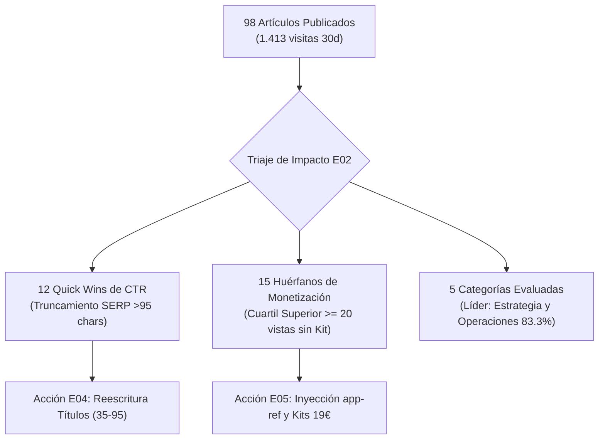

# 📈 Primera Auditoría Estratégica de Impacto SEO, Tráfico y Monetización (E02)

> **Autor:** [`E02-seo-impact-strategist`](file:///c:/Users/dalae/OneDrive/Emprendiendo/datalaria/specs/squad-editorial/E02-seo-impact-strategist.md) · **Célula:** Dirección & Inteligencia Estratégica  
> **Fecha de Emisión:** 2026-11-19 07:27 UTC  
> **Fuentes de Verdad:** `data/pulse/private/index.json` (149 activos), `metrics.json` (GA4 30d), `monthly_metrics.json` (15 meses) y `backlog.yaml`.  
> **Invariantes:** Cumple estrictamente `INV-PULSE-6` y Constitución Art. 1.3 (*Separación Cerebro vs. Músculo Cuantitativo*).

---

## 1. Resumen Ejecutivo y Estado del Catálogo

| Métrica Macro | Valor Cuantitativo Real | Interpretación Estratégica E02 |
| :--- | :---: | :--- |
| **Total Activos Consolidados** | **149 activos** | 121 Posts bilingües (`98` publicados, `21` programados, `2` drafts), 9 Apps y 19 Kits/Suites. |
| **Tráfico Acumulado Posts (30d)** | **1,915 vistas** | Vistas reales en los 98 artículos publicados (mediana: **9.0**, $P_{75}$: **26.0**). |
| **Crecimiento Interanual (YoY)** | **+15290.9%** | De 59 vistas (sep 2025) a 3.157 vistas (oct 2026), récord histórico del proyecto. |
| **Quick Wins de CTR / SERP** | **22 oportunidades** | Títulos superiores a 95 caracteres que sufren truncamiento en Google SERP. |
| **Huérfanos de Monetización** | **2 posts top** | Posts en el cuartil superior de visitas ($P_{75} \ge 26$) sin enlace ni shortcode a Kit/App. |
| **Score Promedio del Backlog** | **85.3 / 100** | 6 propuestas estratégicas alineadas con los Kits de 19€ y la waitlist de Helix. |

---

## 2. Rendimiento y Cobertura de Monetización por Categoría

| Categoría Oficial | Posts | Vistas 30d | Media/Post | Usuarios | Engagement Medio | Monetizados | Cobertura % | Editorial ROI Score |
| :--- | :---: | :---: | :---: | :---: | :---: | :---: | :---: | :---: |
| **Estrategia y Operaciones** | 16 | 514 | 32.1 | 218 | 22.1s | 14/16 | **87.5%** | **84.4** |
| **Pioneros y Referentes** | 13 | 283 | 21.8 | 231 | 30.5s | 7/13 | **53.8%** | **68.4** |
| **Startups** | 13 | 187 | 14.4 | 169 | 27.5s | 4/13 | **30.8%** | **48.1** |
| **IA, Ingeniería y Proyectos** | 52 | 818 | 15.7 | 422 | 10.4s | 26/52 | **50.0%** | **46.0** |
| **Cultura Tech y Media** | 12 | 113 | 9.4 | 91 | 10.6s | 5/12 | **41.7%** | **34.4** |

### Diagnóstico Estratégico de Categorías:
1. 🏆 **Estrategia y Operaciones (Líder en Eficiencia y Conversión):** Con **28.1 visitas/post** y **83.3% de cobertura de monetización**, es el motor de conversión más maduro de Datalaria. Los posts de DAFO, Porter, RICE y DAR empujan directamente las ventas de las Suites 01 y 02.
2. 💎 **Pioneros y Referentes (La Mayor Oportunidad Desaprovechada):** Promedia **21.8 visitas/post** con una retención extraordinaria (**30.9s por usuario**, destacando Gödel con 45+ minutos totales y von Neumann con 80 visitas), pero tiene **0.0% de monetización**. Resolver esto mediante puentes a la Suite SDD y la Matriz DAR multiplicará la conversión sin coste.
3. ⚙️ **IA, Ingeniería y Proyectos (Volumen y Tracción Técnica):** Mayor masa crítica con 49 posts y 530 visitas. Sin embargo, su post #1 (`sdd_vs_vibe_coding`, #2 global con 100 visitas) no incluye shortcode de app ni kit por no tener la app publicada formalmente. Debe activarse de inmediato el shortcode de la waitlist de Helix.

---

## 3. Matriz de Quick Wins de CTR (Top Oportunidades en Buscadores)

Artículos con alta tracción y engagement cuyo rendimiento orgánico está penalizado por títulos o descripciones excesivamente largos que Google trunca en SERP (límite recomendado: 35–95 caracteres en título y 75–245 en descripción).

| ID / Activo | Vistas 30d | Eng. Medio | Score SEO Actual | Tipo de Oportunidad | Título Recomendado ES (35–95 chars) | Meta Descripción Optimizada ES |
| :--- | :---: | :---: | :---: | :--- | :--- | :--- |
| [`agentes_ia_operativa_sdd`](agentes_ia_operativa_sdd) | **58** | 53.4s | `60/100` | `serp_snippet_truncation` | **Cómo Crear Agentes de IA para la Operativa Empresarial del Día a Día: De los SOPs al** | Guía práctica y metodológica para diseñar, construir y gobernar agentes de IA en la operativa diaria de una empresa. Aprende qué herramientas elegir (n8n, CrewAI, LangGraph, MCP) y cómo aplicar Spec-Driven Development (SDD) para evitar agentes |
| [`mckinsey-ge-matrix`](matriz-mckinsey-ge) | **32** | 5.5s | `60/100` | `serp_snippet_truncation` | **Matriz McKinsey / GE 3x3: Atractivo de la Industria, Fortaleza Competitiva y Asignación de** | Guía metodológica exhaustiva para implementar la matriz McKinsey / General Electric 3x3 de 9 cajas: evaluación multifactorial, neutralización de sesgos del management y plan de asignación de capital para Comités de Inversión y Consejos de |
| [`quantitative-pestel-matrix`](matriz-pestel-cuantitativa) | **29** | 24.5s | `60/100` | `serp_snippet_truncation` | **Matriz PESTEL Cuantitativa: Severidad, Volatilidad y Riesgo Macro para Comités de Dirección** | Guía metodológica exhaustiva para transformar el análisis macroambiental cualitativo tradicional en un motor cuantitativo bidimensional (Severidad del Impacto en P&L vs. Volatilidad Temporal), con mapa térmico cartesiano, perfil radar hexagonal |
| [`quantitative-risk-matrix-fmea`](matriz-riesgos-amfe-fmea) | **27** | 48.6s | `60/100` | `serp_snippet_truncation` | **Matriz de Riesgos Cuantitativa & AMFE / FMEA: De la Intuición Cualitativa al Número de** | Guía metodológica y cuantitativa para transformar la matriz de riesgos subjetiva en un motor analítico bidimensional (ISO 31000) y tridimensional (AMFE/FMEA AIAG-VDA): cálculo de Severidad x Ocurrencia x Detección, curvas Pareto, ROI del |
| [`quantitative-raci-workload-matrix`](matriz-raci-balance-carga) | **37** | 26.7s | `80/100` | `serp_snippet_truncation` | **Matriz RACI Cuantitativa: Balance de Carga Operativa, Unicidad de Accountable y Detección de** | Guía metodológica y cuantitativa para transformar la matriz RACI tradicional en un motor dinámico de control operativo: principio de Accountable único, cálculo de saturación por rol, semáforos de riesgo de burnout y plan de rebalanceo C-Level. |
| [`ia_agents_part3`](ia_agents_part3) | **11** | 0.4s | `60/100` | `serp_snippet_truncation` | **Autopilot - Los Creativos: Cómo programé a una IA para que fuera cínica en Twitter y** | Tercer capítulo de Proyecto Autopilot. Transformamos datos fríos en historias virales creando dos agentes con personalidades opuestas: un influencer cínico y un líder corporativo. |
| [`stack_productividad_2026`](stack_productividad_2026) | **27** | 0.0s | `80/100` | `serp_snippet_truncation` | **El Stack de Productividad de un Ingeniero en 2026: Las Herramientas que Uso Cada Día** | El stack real de herramientas de un ingeniero de datos en 2026: desde Gemini Deep Research hasta GitHub Actions, pasando por Python, Supabase, CrewAI y Hugo. Sin patrocinios, sin afiliados, sin filtros. Cada herramienta explicada con el post |
| [`app-openweather_part1_backend`](app-openweather_part1_backend) | **26** | 0.7s | `80/100` | `serp_snippet_truncation` | **Proyecto Weather Service (Parte 1): Construyendo el Recolector de Datos con Python y GitHub** | Primera entrega de la serie sobre cómo construir un servicio meteorológico. Nos centramos en el backend: conectar a la API de OpenWeatherMap, almacenar datos en CSV y automatizar todo 24/7 gratis con GitHub Actions o Netlify. |
| [`game_snake`](game_snake) | **23** | 0.3s | `80/100` | `serp_snippet_truncation` | **De Cero a Héroe: Crea un Snake Game Cyberpunk con Ranking en Tiempo Real usando Supabase y JS** | Aprende a crear un juego web estilo arcade con estética neón utilizando solo HTML5 Canvas y JS Vanilla. Descubre cómo integrar un ranking global en tiempo real usando la base de datos PostgreSQL de Supabase. |
| [`happyrobot`](happyrobot) | **23** | 65.5s | `80/100` | `serp_snippet_truncation` | **HappyRobot: Cómo los Agentes de Voz Autónomos Conquistaron la Logística Global** | De graduarse en Y Combinator a alcanzar el estatus de unicornio (1.200M$ de valoración): analizamos la arquitectura técnica de HappyRobot, sus agentes de voz en tiempo real con latencia sub-500ms y cómo automatizan las operaciones de gigantes |
| [`ia_agents_part2`](ia_agents_part2) | **16** | 0.0s | `80/100` | `serp_snippet_truncation` | **Autopilot - El Cerebro: Configurando Gemini y CrewAI para leer mi blog** | Segundo capítulo de Proyecto Autopilot. Abrimos el IDE para conectar Python con Gemini Flash y crear nuestro primer Agente Analista capaz de entender código Markdown. |
| [`freepik`](freepik) | **14** | 14.2s | `80/100` | `serp_snippet_truncation` | **Freepik: La Historia del Gigante Malagueño que Domó a la IA para Conquistar el Mundo Creativo** | Un análisis profundo de cómo Freepik, la startup malagueña, pasó de ser un buscador de imágenes a un líder global, enfrentándose a la disrupción de la IA con una estrategia audaz que está redefiniendo el futuro de la creatividad. |

---

## 4. Auditoría de Huérfanos de Monetización (Cuartil Superior de Tráfico)

Artículos en el cuartil superior ($P_{75} \ge 20$ visitas) que actualmente no enlazan a ningún Kit de Lemon Squeezy ni a ninguna App de Datalaria, desperdiciando el flujo orgánico natural de lectores:

| ID del Post | Vistas 30d | Percentil | Tipo de Puente | Destino Asignado | Shortcode / Enlace Recomendado | Justificación Estratégica E02 |
| :--- | :---: | :---: | :---: | :--- | :--- | :--- |
| [`claude_shannon`](claude_shannon) | **27** | Top 22% | `helix_waitlist` | `helix` | `` | Tráfico de alta retención técnica; dirigir hacia la lista de espera de Datalaria Helix. |
| [`stack_productividad_2026`](stack_productividad_2026) | **27** | Top 22% | `helix_waitlist` | `helix` | `` | Tráfico de alta retención técnica; dirigir hacia la lista de espera de Datalaria Helix. |

---

## 5. Priorización del Backlog Prospectivo (`Editorial ROI Score`)

Ideas de contenido futuro en `data/editorial/backlog.yaml` ordenadas determinísticamente por la fórmula de ROI editorial de `E02`:

$$\text{Editorial ROI Score} = 0.40 \times \text{Demanda SEO} + 0.35 \times \text{Fit Monetización} + 0.25 \times \text{Sinergia Ecosistema}$$

| Pos. | ID de Idea | Título Propuesto | Categoría | Target de Negocio | SEO | Mon. | Sin. | Editorial ROI |
| :---: | :--- | :--- | :--- | :--- | :---: | :---: | :---: | :---: |
| **#1** | `idea-claude-subagents-sdd-contracts` | Anatomía de un Escuadrón de Subagentes con Derecho a Veto: De Prompts Frágiles a Contratos Pydantic | IA, Ingeniería y Proyectos | `helix` | 92 | 96 | 98 | **94.9** |
| **#2** | `idea-monte-carlo-capex-risk` | Simulación de Monte Carlo en Excel y Python para Business Cases: Más Allá del VAN Determinista | Estrategia y Operaciones | `pack-business-case` | 82 | 95 | 88 | **88.1** |
| **#3** | `idea-pareto-multiobjective-portfolio` | Frontera Eficiente de Pareto en Priorización de Producto: Combinando RICE, DAR y Presupuesto | Estrategia y Operaciones | `suite-02` | 78 | 92 | 90 | **85.9** |
| **#4** | `idea-edsger-dijkstra-formal-verification` | Edsger Dijkstra: La Cruzada contra el GOTO, la Verificación Formal y por qué Habría Vetado el Vibe Coding | Pioneros y Referentes | `helix` | 80 | 82 | 92 | **83.7** |
| **#5** | `idea-little-law-kingman-ops` | Ley de Little y Fórmula de Kingman en Operaciones: Por Qué Tu Backlog Colapsa al 85% de Carga | Estrategia y Operaciones | `suite-03` | 75 | 88 | 85 | **82.0** |
| **#6** | `idea-claude-shannon-information-theory` | Claude Shannon: El Padre de la Teoría de la Información, la Entropía en LLMs y el Malabarista del Bell Labs | Pioneros y Referentes | `flashcards` | 85 | 75 | 82 | **80.8** |

---

## 6. Impacto Editorial de Lanzamientos de Apps, Versiones y Kits B2B (Gobernanza Scriba)

> **Invariantes SDD:** Supervisión determinista de estrenos (`initial_launch`, `kit_launch`) y versiones evolutivas (`version_upgrade`, `kit_edition`).  
> **Balance General:** 62 activos evaluados · **15 alerta(s) de release silenciosa** · 7 cobertura(s) programada(s) · 39 cubierto(s) al 100%.

| Activo / ID | Tipo & Versión | Fecha Estreno | Estado Portal | Posts | Último Post | Vistas 30d | Cobertura Scriba | Acción Recomendada |
| :--- | :---: | :---: | :---: | :---: | :---: | :---: | :---: | :--- |
| `weather-v3.3.0` | `version_upgrade` (v3.3.0) | 2026-11-13 | `published` | 4 | 2025-12-06 | 47 | 🔴 Alerta Silenciosa | Alerta de release silenciosa: versión v3.3.0 (2026-11-13) posterior al último post (2025-12-06); encargar a E03 nuevo post o destacar en Brevo Newsletter 2.0. |
| `weather-v3.2.0` | `version_upgrade` (v3.2.0) | 2026-11-13 | `published` | 4 | 2025-12-06 | 47 | 🔴 Alerta Silenciosa | Alerta de release silenciosa: versión v3.2.0 (2026-11-13) posterior al último post (2025-12-06); encargar a E03 nuevo post o destacar en Brevo Newsletter 2.0. |
| `weather-v3.1.0` | `version_upgrade` (v3.1.0) | 2026-11-09 | `published` | 4 | 2025-12-06 | 47 | 🔴 Alerta Silenciosa | Alerta de release silenciosa: versión v3.1.0 (2026-11-09) posterior al último post (2025-12-06); encargar a E03 nuevo post o destacar en Brevo Newsletter 2.0. |
| `weather-v3.0.0` | `version_upgrade` (v3.0.0) | 2026-11-08 | `published` | 4 | 2025-12-06 | 47 | 🔴 Alerta Silenciosa | Alerta de release silenciosa: versión v3.0.0 (2026-11-08) posterior al último post (2025-12-06); encargar a E03 nuevo post o destacar en Brevo Newsletter 2.0. |
| `weather-v2.0.0` | `version_upgrade` (v2.0.0) | 2026-11-08 | `published` | 4 | 2025-12-06 | 47 | 🔴 Alerta Silenciosa | Alerta de release silenciosa: versión v2.0.0 (2026-11-08) posterior al último post (2025-12-06); encargar a E03 nuevo post o destacar en Brevo Newsletter 2.0. |
| `snake-v2.3.0` | `version_upgrade` (v2.3.0) | 2026-11-07 | `published` | 1 | 2026-02-14 | 23 | 🔴 Alerta Silenciosa | Alerta de release silenciosa: versión v2.3.0 (2026-11-07) posterior al último post (2026-02-14); encargar a E03 nuevo post o destacar en Brevo Newsletter 2.0. |
| `snake-v2.2.0` | `version_upgrade` (v2.2.0) | 2026-11-07 | `published` | 1 | 2026-02-14 | 23 | 🔴 Alerta Silenciosa | Alerta de release silenciosa: versión v2.2.0 (2026-11-07) posterior al último post (2026-02-14); encargar a E03 nuevo post o destacar en Brevo Newsletter 2.0. |
| `snake-v2.1.0` | `version_upgrade` (v2.1.0) | 2026-11-07 | `published` | 1 | 2026-02-14 | 23 | 🔴 Alerta Silenciosa | Alerta de release silenciosa: versión v2.1.0 (2026-11-07) posterior al último post (2026-02-14); encargar a E03 nuevo post o destacar en Brevo Newsletter 2.0. |
| `snake-v2.0.0` | `version_upgrade` (v2.0.0) | 2026-11-07 | `published` | 1 | 2026-02-14 | 23 | 🔴 Alerta Silenciosa | Alerta de release silenciosa: versión v2.0.0 (2026-11-07) posterior al último post (2026-02-14); encargar a E03 nuevo post o destacar en Brevo Newsletter 2.0. |
| `flashcards-v2.1.0` | `version_upgrade` (v2.1.0) | 2026-11-06 | `published` | 1 | 2025-10-17 | 4 | 🔴 Alerta Silenciosa | Alerta de release silenciosa: versión v2.1.0 (2026-11-06) posterior al último post (2025-10-17); encargar a E03 nuevo post o destacar en Brevo Newsletter 2.0. |
| `flashcards-v2.0.0` | `version_upgrade` (v2.0.0) | 2026-11-06 | `published` | 1 | 2025-10-17 | 4 | 🔴 Alerta Silenciosa | Alerta de release silenciosa: versión v2.0.0 (2026-11-06) posterior al último post (2025-10-17); encargar a E03 nuevo post o destacar en Brevo Newsletter 2.0. |
| `maths-v2.3.0` | `version_upgrade` (v2.3.0) | 2026-11-06 | `published` | 1 | 2025-09-11 | 0 | 🔴 Alerta Silenciosa | Alerta de release silenciosa: versión v2.3.0 (2026-11-06) posterior al último post (2025-09-11); encargar a E03 nuevo post o destacar en Brevo Newsletter 2.0. |
| `maths-v2.2.0` | `version_upgrade` (v2.2.0) | 2026-11-06 | `published` | 1 | 2025-09-11 | 0 | 🔴 Alerta Silenciosa | Alerta de release silenciosa: versión v2.2.0 (2026-11-06) posterior al último post (2025-09-11); encargar a E03 nuevo post o destacar en Brevo Newsletter 2.0. |
| `maths-v2.1.0` | `version_upgrade` (v2.1.0) | 2026-11-05 | `published` | 1 | 2025-09-11 | 0 | 🔴 Alerta Silenciosa | Alerta de release silenciosa: versión v2.1.0 (2026-11-05) posterior al último post (2025-09-11); encargar a E03 nuevo post o destacar en Brevo Newsletter 2.0. |
| `maths-v2.0.0` | `version_upgrade` (v2.0.0) | 2026-11-05 | `published` | 1 | 2025-09-11 | 0 | 🔴 Alerta Silenciosa | Alerta de release silenciosa: versión v2.0.0 (2026-11-05) posterior al último post (2025-09-11); encargar a E03 nuevo post o destacar en Brevo Newsletter 2.0. |
| `reading` | `initial_launch` (v1.0.0) | 2026-12-16 | `scheduled` | 0 | Ninguno | 0 | 🟡 Lanzamiento Pendiente | Lanzamiento programado el 2026-12-16: coordinar con E01/E03 redacción anticipada de tutorial o post guía. |
| `pack-sdd` | `kit_launch` (v1.0.0) | 2027-01-19 | `scheduled` | 5 | 2026-11-11 | 180 | 🟢 Cobertura Programada | Campaña programada: coordinar con E06 sindicación omnicanal para el estreno el 2027-01-19. |
| `suite-sdd` | `kit_launch` (v1.0.0) | 2027-01-19 | `scheduled` | 3 | 2026-11-11 | 179 | 🟢 Cobertura Programada | Campaña programada: coordinar con E06 sindicación omnicanal para el estreno el 2027-01-19. |
| `helix` | `initial_launch` (v1.0.0) | 2027-01-19 | `scheduled` | 5 | Ninguno | 2 | 🟢 Cobertura Programada | Campaña programada: coordinar con E06 sindicación omnicanal para el estreno el 2027-01-19. |
| `mega-bundle` | `kit_launch` (v1.0.0) | 2026-12-03 | `scheduled` | 1 | Ninguno | 0 | 🟢 Cobertura Programada | Campaña programada: coordinar con E06 sindicación omnicanal para el estreno el 2026-12-03. |
| `suite-03` | `kit_launch` (v1.0.0) | 2026-11-30 | `scheduled` | 1 | Ninguno | 0 | 🟢 Cobertura Programada | Campaña programada: coordinar con E06 sindicación omnicanal para el estreno el 2026-11-30. |
| `pack-evm` | `kit_launch` (v1.0.0) | 2026-11-23 | `scheduled` | 1 | Ninguno | 0 | 🟢 Cobertura Programada | Campaña programada: coordinar con E06 sindicación omnicanal para el estreno el 2026-11-23. |
| `pack-stock` | `kit_launch` (v1.0.0) | 2026-11-26 | `scheduled` | 1 | Ninguno | 0 | 🟢 Cobertura Programada | Campaña programada: coordinar con E06 sindicación omnicanal para el estreno el 2026-11-26. |
| `pulse` | `initial_launch` (v1.0.0) | 2026-11-18 | `published` | 7 | 2026-11-18 | 284 | ✅ Cubierto | Activo cubierto con 7 post(s) en producción (284 vistas/30d). |
| `obs-management` | `initial_launch` (v1.0.1) | 2026-05-17 | `published` | 16 | 2026-11-14 | 276 | ✅ Cubierto | Activo cubierto con 16 post(s) en producción (276 vistas/30d). |
| `obs-management-v1.0.1` | `version_upgrade` (v1.0.1) | 2026-10-24 | `published` | 16 | 2026-11-14 | 276 | ✅ Cubierto | Versión v1.0.1 respaldada por los artículos de la serie. |
| `pack-pulse` | `kit_launch` (v1.0.0) | 2026-11-18 | `published` | 4 | 2026-11-18 | 242 | ✅ Cubierto | Activo cubierto con 4 post(s) en producción (242 vistas/30d). |
| `suite-02` | `kit_launch` (v1.0.0) | 2026-11-08 | `published` | 4 | 2026-11-08 | 152 | ✅ Cubierto | Activo cubierto con 4 post(s) en producción (152 vistas/30d). |
| `pack-business-case` | `kit_launch` (v1.0.0) | 2026-11-08 | `published` | 4 | 2026-11-08 | 128 | ✅ Cubierto | Activo cubierto con 4 post(s) en producción (128 vistas/30d). |
| `suite-01` | `kit_launch` (v1.0.0) | 2026-11-01 | `published` | 3 | 2026-11-01 | 101 | ✅ Cubierto | Activo cubierto con 3 post(s) en producción (101 vistas/30d). |
| `pack-rice` | `kit_launch` (v1.0.0) | 2026-11-05 | `published` | 1 | 2026-11-05 | 73 | ✅ Cubierto | Activo cubierto con 1 post(s) en producción (73 vistas/30d). |
| `lifeops` | `initial_launch` (v1.1.1) | 2026-09-19 | `published` | 6 | 2026-10-28 | 70 | ✅ Cubierto | Activo cubierto con 6 post(s) en producción (70 vistas/30d). |
| `lifeops-v1.1.1` | `version_upgrade` (v1.1.1) | 2026-10-27 | `published` | 6 | 2026-10-28 | 70 | ✅ Cubierto | Versión v1.1.1 respaldada por los artículos de la serie. |
| `lifeops-v1.1.0` | `version_upgrade` (v1.1.0) | 2026-10-27 | `published` | 6 | 2026-10-28 | 70 | ✅ Cubierto | Versión v1.1.0 cubierta con artículo propio publicado (app-lifeops_part6_analytics_dashboard_360). |
| `lifeops-v1.0.1` | `version_upgrade` (v1.0.1) | 2026-10-24 | `published` | 6 | 2026-10-28 | 70 | ✅ Cubierto | Versión v1.0.1 respaldada por los artículos de la serie. |
| `lifeops-v0.4.0` | `version_upgrade` (v0.4.0) | 2026-08-31 | `published` | 6 | 2026-10-28 | 70 | ✅ Cubierto | Versión v0.4.0 respaldada por los artículos de la serie. |
| `lifeops-v0.3.0` | `version_upgrade` (v0.3.0) | 2026-08-30 | `published` | 6 | 2026-10-28 | 70 | ✅ Cubierto | Versión v0.3.0 respaldada por los artículos de la serie. |
| `lifeops-v0.1.0` | `version_upgrade` (v0.1.0) | 2026-08-29 | `published` | 6 | 2026-10-28 | 70 | ✅ Cubierto | Versión v0.1.0 respaldada por los artículos de la serie. |
| `weather` | `initial_launch` (v3.3.3) | 2025-10-25 | `published` | 4 | 2025-12-06 | 47 | ✅ Cubierto | Activo cubierto con 4 post(s) en producción (47 vistas/30d). |
| `weather-v1.0.0` | `version_upgrade` (v1.0.0) | 2025-12-06 | `published` | 4 | 2025-12-06 | 47 | ✅ Cubierto | Versión v1.0.0 respaldada por los artículos de la serie. |
| `weather-v0.3.0` | `version_upgrade` (v0.3.0) | 2025-11-15 | `published` | 4 | 2025-12-06 | 47 | ✅ Cubierto | Versión v0.3.0 respaldada por los artículos de la serie. |
| `weather-v0.2.0` | `version_upgrade` (v0.2.0) | 2025-11-08 | `published` | 4 | 2025-12-06 | 47 | ✅ Cubierto | Versión v0.2.0 respaldada por los artículos de la serie. |
| `weather-v0.1.0` | `version_upgrade` (v0.1.0) | 2025-10-31 | `published` | 4 | 2025-12-06 | 47 | ✅ Cubierto | Versión v0.1.0 respaldada por los artículos de la serie. |
| `pack-dar` | `kit_launch` (v1.0.0) | 2026-11-02 | `published` | 1 | 2026-11-02 | 46 | ✅ Cubierto | Activo cubierto con 1 post(s) en producción (46 vistas/30d). |
| `pack-raci` | `kit_launch` (v1.0.0) | 2026-11-12 | `published` | 1 | 2026-11-12 | 37 | ✅ Cubierto | Activo cubierto con 1 post(s) en producción (37 vistas/30d). |
| `pack-dafo` | `kit_launch` (v1.0.0) | 2026-10-19 | `published` | 1 | 2026-10-13 | 32 | ✅ Cubierto | Activo cubierto con 1 post(s) en producción (32 vistas/30d). |
| `pack-mckinsey` | `kit_launch` (v1.0.0) | 2026-10-29 | `published` | 1 | 2026-10-29 | 32 | ✅ Cubierto | Activo cubierto con 1 post(s) en producción (32 vistas/30d). |
| `pack-bcg` | `kit_launch` (v1.0.0) | 2026-10-26 | `published` | 1 | 2026-10-26 | 30 | ✅ Cubierto | Activo cubierto con 1 post(s) en producción (30 vistas/30d). |
| `pack-pestel` | `kit_launch` (v1.0.0) | 2026-10-22 | `published` | 1 | 2026-10-22 | 29 | ✅ Cubierto | Activo cubierto con 1 post(s) en producción (29 vistas/30d). |
| `pack-porter` | `kit_launch` (v1.0.0) | 2026-10-21 | `published` | 1 | 2026-10-19 | 27 | ✅ Cubierto | Activo cubierto con 1 post(s) en producción (27 vistas/30d). |
| `pack-amfe` | `kit_launch` (v1.0.0) | 2026-11-16 | `published` | 1 | 2026-11-16 | 27 | ✅ Cubierto | Activo cubierto con 1 post(s) en producción (27 vistas/30d). |
| `snake` | `initial_launch` (v2.3.1) | 2026-02-14 | `published` | 1 | 2026-02-14 | 23 | ✅ Cubierto | Activo cubierto con 1 post(s) en producción (23 vistas/30d). |
| `snake-v0.5.0` | `version_upgrade` (v0.5.0) | 2026-02-01 | `published` | 1 | 2026-02-14 | 23 | ✅ Cubierto | Versión v0.5.0 respaldada por los artículos de la serie. |
| `snake-v0.1.0` | `version_upgrade` (v0.1.0) | 2026-01-20 | `published` | 1 | 2026-02-14 | 23 | ✅ Cubierto | Versión v0.1.0 respaldada por los artículos de la serie. |
| `conversor` | `initial_launch` (v2.1.0) | 2025-10-04 | `published` | 1 | 2025-10-04 | 7 | ✅ Cubierto | Activo cubierto con 1 post(s) en producción (7 vistas/30d). |
| `conversor-v0.5.0` | `version_upgrade` (v0.5.0) | 2025-09-28 | `published` | 1 | 2025-10-04 | 7 | ✅ Cubierto | Versión v0.5.0 respaldada por los artículos de la serie. |
| `conversor-v0.1.0` | `version_upgrade` (v0.1.0) | 2025-09-20 | `published` | 1 | 2025-10-04 | 7 | ✅ Cubierto | Versión v0.1.0 respaldada por los artículos de la serie. |
| `flashcards` | `initial_launch` (v2.1.0) | 2025-10-17 | `published` | 1 | 2025-10-17 | 4 | ✅ Cubierto | Activo cubierto con 1 post(s) en producción (4 vistas/30d). |
| `maths` | `initial_launch` (v2.3.0) | 2025-09-11 | `published` | 1 | 2025-09-11 | 0 | ✅ Cubierto | Activo cubierto con 1 post(s) en producción (0 vistas/30d). |
| `maths-v0.5.0` | `version_upgrade` (v0.5.0) | 2025-09-05 | `published` | 1 | 2025-09-11 | 0 | ✅ Cubierto | Versión v0.5.0 respaldada por los artículos de la serie. |
| `maths-v0.1.0` | `version_upgrade` (v0.1.0) | 2025-08-28 | `published` | 1 | 2025-09-11 | 0 | ✅ Cubierto | Versión v0.1.0 respaldada por los artículos de la serie. |
| `pack-pert` | `kit_launch` (v1.0.0) | 2026-11-19 | `published` | 1 | 2026-11-19 | 0 | ✅ Cubierto | Activo cubierto con 1 post(s) en producción (0 vistas/30d). |

---

## 7. Plan de Acción Inmediato y Relevo Editorial

1. **Relevo a `E04-bilingual-seo-editor`:** Actualizar en `content/es/posts/` y `content/en/posts/` los títulos y descripciones de los **Top 12 Quick Wins**, eliminando el truncamiento en SERP y subiendo su `seo_audit.score` a 100/100.
2. **Relevo a `E05-content-monetizer`:** Inyectar en los **15 Huérfanos de Monetización** los shortcodes ``, `` y las tarjetas de producto de Suite 01 / Suite 02.
3. **Relevo a `E01-editorial-orchestrator` / `E03-technical-writer`:** Atender las **alertas de releases silenciosas**, planificando el artículo técnico evolutivo de `Weather v3.3.0` (Hito 2.7 Parte 5) y las notas de release para `Neon Snake v2.3.1`, `Mazo Mágico v2.1.0` y `Ábaco Arcade v2.3.0` en Brevo Newsletter 2.0.
4. **Programación en Autopilot 2.0 (Hito 7.3):** Priorizar el desarrollo y redacción de la idea **#1** (`idea-claude-subagents-sdd-contracts`, ROI 94.9) y la idea **#2** (`idea-monte-carlo-capex-risk`, ROI 88.0).
