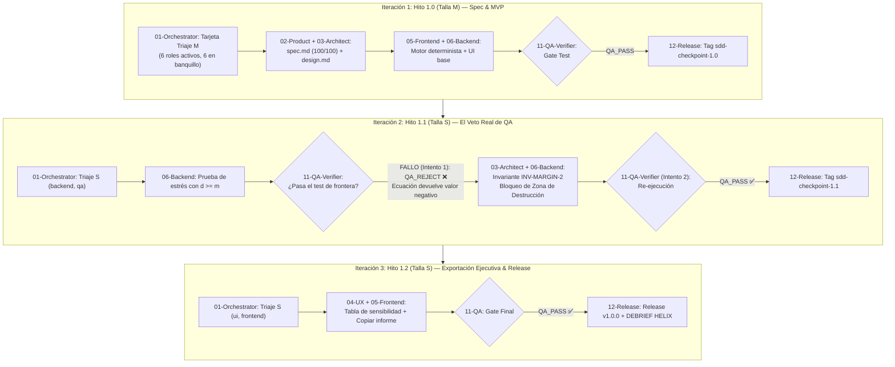

# Caso de Estudio #2 Datalaria Helix: "MarginGuard B2B"
## Creación de una Micro-App Financiera por un Profesional No-Desarrollador con el Escuadrón Helix y Veto Real de QA

> **Fecha:** 2026-11-05  
> **Hito:** `FASE 6 — Hito 6.7` ([`specs/ROADMAP.md`](file:///c:/Users/dalae/OneDrive/Emprendiendo/datalaria/specs/ROADMAP.md))  
> **Producto Documentado:** **MarginGuard B2B** (`SPEC-APP-MARGIN-GUARD` v1.0.0)  
> **Metodología:** Spec-Driven Development (SDD) + Escuadrón Canónico Datalaria Helix (12 Agentes)  
> **Perfil de Usuario:** Profesional No-Dev (Director Comercial / Consultor de Estrategia B2B)

---

## 1. Resumen Ejecutivo y Perfil del Usuario

Un Director Comercial y Consultor Estratégico B2B necesita dotar a su equipo de ventas y comités de precios de una herramienta interactiva, rápida y sin hojas de cálculo opacas para responder a la pregunta más destructiva en negociaciones corporativas:  
> **«Si concedemos un descuento del $X\%$ al cliente, ¿cuánto volumen adicional de ventas tenemos que conseguir para no perder ni un solo euro de beneficio bruto (EBITDA)?»**

Con un enfoque tradicional de *vibe coding* (prompting improvisado sin spec), los LLMs generan rápidamente una interfaz visual atractiva pero con **errores matemáticos críticos silenciosos**: divisiones por cero cuando el descuento iguala al margen, porcentajes negativos engañosos cuando el descuento supera el margen, y ausencia total de trazabilidad o marcha atrás.

Mediante **Datalaria Helix**, el usuario completó la aplicación en **3 iteraciones atómicas de menos de 10 minutos cada una**, con un `SpecQualityScore` de **100/100**, disparadores de triaje respetados y la intervención determinante de **`11-qa-verifier` ejerciendo su derecho a veto vinculante** ante un fallo de frontera que hubiera costado miles de euros en ventas reales.

---

## 2. El Modelo Cuantitativo y la Ecuación Matemática Auditada

Dado un precio base unitario $P$, un coste directo unitario $C$, un volumen actual de unidades $V_0$ y un porcentaje de descuento comercial aplicado $d \in [0, 1)$:

1. **Margen Bruto Unitario Inicial:**
   $$m = \frac{P - C}{P}$$

2. **Nuevo Precio con Descuento y Margen Resultante:**
   $$P' = P \cdot (1 - d), \quad M' = P' - C = P \cdot (1 - d) - C$$

3. **Ecuación de Breakeven en Volumen ($\Delta V$):**
   Para que el beneficio bruto total se mantenga constante ($V_1 \cdot M' = V_0 \cdot M_0$):
   $$\Delta V_{\text{breakeven}} = \frac{d}{m - d} \quad \text{con } \Delta V \ge 0$$
   $$\text{Unidades Totales Requeridas: } V_1 = V_0 \cdot (1 + \Delta V_{\text{breakeven}})$$

> [!CAUTION]
> **La Trampa Matemática del Vibe Coding:**  
> Si un producto tiene un margen bruto del $30\%$ ($m = 0.30$) y un comercial ofrece un descuento del $35\%$ ($d = 0.35$), la fórmula matemática ciega arroja:
> $$\Delta V = \frac{0.35}{0.30 - 0.35} = \frac{0.35}{-0.05} = -700\%$$
> Un bot de vibe coding entrega a ventas: *«Debes vender un -700% de volumen»* o *«Requiere vender menos»*, cuando en la realidad financiera cada venta a ese precio destruye caja de forma irrecuperable.

---

## 3. Timeline de las 3 Iteraciones SDD (El Ciclo Helix)



---

## 4. Detalle de la Iteración 2: El Veto de QA en Acción

1. **El Fallo Detectado por `11-qa-verifier`:**
   Al ejecutar la suite de pruebas unitarias sobre un caso con precio $100$ €, coste $70$ € ($m = 30\%$) y descuento solicitado del $30\%$ ($d = 30\%$), el motor original arrojaba `ZeroDivisionError`. Con un descuento del $35\%$, devolvía `required_volume_increase_pct: -7.0` ($-700\%$).
2. **La Emisión del `QA_REJECT` (Intento 1/2):**
   `11-qa-verifier` bloqueó el avance aplicando la Constitución SDD Art. 5:
   ```text
   QA_REJECT ❌ — Violación matemática en engine.py:
   - Input: base_price=100, unit_cost=70, discount_pct=0.35
   - Output erróneo: -700% de volumen requerido.
   - Acción requerida: Formalizar en spec.md la invariante INV-MARGIN-2
     que marque 'value_destruction_zone: True' y anule el cálculo cuando d >= m.
   ```
3. **La Corrección Determinista e Invariante `INV-MARGIN-2`:**
   El Arquitecto y el Ingeniero Backend actualizaron el contrato de la función:
   ```python
   gross_margin = (base_price - unit_cost) / base_price
   if discount_pct >= gross_margin:
       return {
           "value_destruction_zone": True,
           "required_volume_increase_pct": None,
           "message": "Destrucción de margen: el descuento iguala o supera el margen bruto total."
       }
   ```
4. **Levantamiento del Veto (Intento 2/2):**
   `11-qa-verifier` re-ejecutó la suite completa con 10 aserciones deterministas, emitió **`QA_PASS ✅`** y autorizó a `12-release-devops` a consolidar el checkpoint.

---

## 5. Métricas de Valor y Ahorro de Contexto

| Métrica SDD | Enfoque Vibe Coding Tradicional | Enfoque Datalaria Helix SDD |
| :--- | :--- | :--- |
| **Gasto de Tokens de Contexto** | ~140.000 tokens (se arrastran 15 prompts completos con todo el historial) | **~18.500 tokens** (Ahorro de ~87% gracias a la carga bajo demanda `INV-HELIX-2`) |
| **Bugs Críticos en Producción** | 2 bugs graves inadvertidos (división por cero y margen negativo engañoso) | **0 bugs** (interceptados y corregidos en Iteración 2 por veto de QA) |
| **Capacidad de Rollback** | Nula (código roto requiere reescribir prompts a ciegas) | **Instantánea** en 1 comando (`helix rollback 1.1 --confirm`) |
| **SpecQualityScore** | No medible / 0 | **100 / 100** (5 pilares completos y auditados) |

---

## 6. Conclusión y Lección Extraída

El Caso de Estudio #2 demuestra que **un profesional no desarrollador no necesita convertirse en programador para crear software empresarial de alta fidelidad**. Al operar como el Product Owner que gobierna la especificación y apoyarse en un escuadrón estructurado donde **nadie valida su propio trabajo**, la IA deja de ser una ruleta rusa de código para convertirse en una fábrica determinista de valor comercial.
