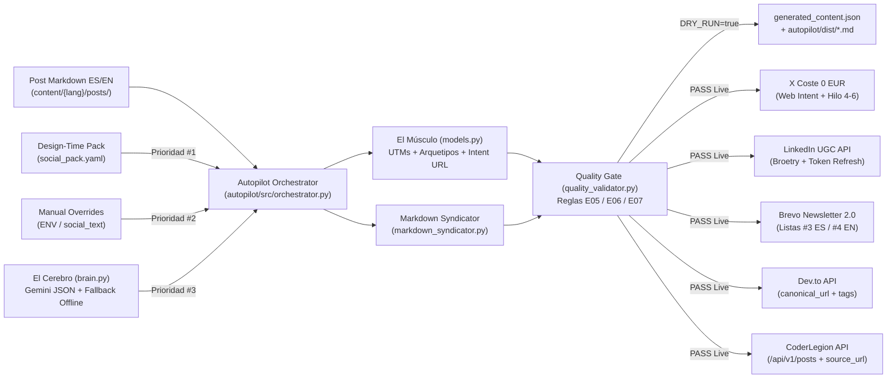

# Especificación Técnica SDD: Datalaria `Autopilot 2.0` y `Brevo Newsletter 2.0 Anti-Churn` (`autopilot`)

> **ID de Especificación:** `SPEC-OPS-AUTOPILOT`  
> **Versión:** `2.1.0`  
> **Estado:** `APPROVED`  
> **Propietario de Dominio:** Datalaria (Superequipo Helix + Scriba · `E05`, `E06`, `E07`, `E08`)  
> **Ubicación del Código Fuente:** `autopilot/`  
> **Workflow CI/CD:** `.github/workflows/autopilot.yml`  
> **Decisiones Arquitectónicas:** `ADR-020`, `ADR-024` & `ADR-025`  

---

## 1. Propósito Ejecutivo y Modelo Operativo (Business Context)

### 1.1 Problema que Resuelve
Transformar la distribución editorial de Datalaria desde un script monolítico acoplado a `gh copilot`, `crewai` y asuntos robóticos (`🚀 Nuevo en Datalaria:`) hacia un **pipeline SDD determinista, auditable y a coste cero en X/Twitter (`0 €/mes`)**, con una **Newsletter Brevo 2.0 Anti-Churn** diseñada para retener suscriptores mediante valor autónomo en bandeja de entrada (*Zero-Click Value*) y conversión orgánica hacia Sandboxes (`?mock=true`) y Recursos B2B.

### 1.2 Frontera de Alcance (Hito 7.3 + Hito 7.4)
- **Dentro de `v2.0.0` (Hito 7.3):** Especificación SDD, limpieza de deuda deprecada (`autopilot/ctrl/`, `*_OLD_DEPRECATED.py`), contratos Pydantic v2 (`models.py`), soporte prioritario para `social_pack.yaml`, blindaje de Hugo (`config.yaml`), validador determinista de calidad (`quality_validator.py`), modo X coste `0 €` (`x.com/intent/tweet` + hilos de 4–6 tweets), cerebro JSON + fallback offline determinista (`brain.py`), plantilla HTML clara anti-churn (`newsletter_manager.py`) y suite `pytest` sin llamadas a APIs externas.
- **Dentro de `v2.1.0` (Hito 7.4):** Transformador universal de Markdown (`markdown_syndicator.py`), contratos `SyndicationConfig` / `SyndicationArtifact`, normalización de tags (`normalize_syndication_tags`), auditoría `audit_markdown_syndication` en `quality_validator.py`, integración REST **CoderLegion** (`/api/v1/posts` con `X-API-Key` y `source_url`) y metadatos enriquecidos de **Dev.to** (`social_manager.py`), aislamiento de `autopilot/dist/` y cortafuegos `config.yaml`, preservando intactos los 8 tests de `autopilot/tests/test_link_resolver.py`.

---

## 2. Arquitectura del Módulo y Flujo de Datos



### 2.1 Manifiesto de Archivos (File Manifest)
| Archivo | Rol y Responsabilidad |
| :--- | :--- |
| `autopilot/__init__.py` & `autopilot/src/__init__.py` | Paquetización limpia para importaciones reproducibles y `pytest`. |
| `autopilot/src/models.py` | **El Músculo:** Contratos Pydantic v2 (`NewsletterContent`, `SocialPlatformX`, `SocialPlatformLinkedIn`, `SyndicationConfig`, `SyndicationArtifact`, `SocialPack`, `QualityAuditReport`) y funciones puras deterministas (`count_twitter_weighted_length`, `build_x_web_intent_url`, `select_subject_archetype`, `append_utm_params`, `normalize_syndication_tags`). |
| `autopilot/src/markdown_syndicator.py` | **Transformador Universal de Markdown:** Convierte shortcodes Hugo (`mermaid`, `app-ref`, `helix-waitlist`, `product-card`, `bundle-card`, `youtube`, `buymeacoffee`, `ref`/`relref`), imágenes y enlaces relativos a Markdown estándar con UTMs, atribución canónica y salida `dist_devto_{lang}.md` / `dist_coderlegion_{lang}.md`. |
| `autopilot/src/quality_validator.py` | **Assurance Gate Determinista:** Auditoría offline de X, LinkedIn, Brevo 2.0 y sindicación Markdown (`audit_markdown_syndication`) sin dependencias externas de CLI ni LLMs (`gh copilot` eliminado). |
| `autopilot/src/brain.py` | **El Cerebro:** Extracción/generación JSON estructurada vía `google-genai` con fallback determinista offline a partir del Markdown real cuando no exista `GEMINI_API_KEY`. |
| `autopilot/src/newsletter_manager.py` | Cliente Brevo API v3 (`#3` ES / `#4` EN) y constructor de la plantilla HTML tabular clara **Brevo Newsletter 2.0 Anti-Churn**. |
| `autopilot/src/social_manager.py` | Gestor omnicanal con política **X Coste 0 €** (`ENABLE_TWITTER_API=false` por defecto), auto-refresh LinkedIn (`.linkedin_new_tokens.json`), `Dev.to` (`canonical_url` + tags) y **CoderLegion** (`/api/v1/posts` con `X-API-Key` y `source_url`). |
| `autopilot/src/orchestrator.py` | Pipeline principal con cascada de prioridad, resolución de Hero cover y CTA secundario seguro (`INV-AUTO-6`), sindicación Dev.to/CoderLegion, validación QA y `DRY_RUN` completo. |
| `autopilot/requirements.txt` | Dependencias activas sin `crewai` ni `langchain-google-genai`. |
| `config.yaml`, `autopilot/.gitignore` & `.github/workflows/autopilot.yml` | Exclusión de `social_pack.yaml` y `dist_*.md` en builds Hugo (`ignoreFiles`), aislamiento de `autopilot/dist/` y pipeline CI/CD con `pytest` previo a `publish`. |

### 2.2 Triaje y Asignación del Superequipo (Helix + Scriba)
- **Rúbricas aplicables:** [`specs/squad/triage-rubric.md`](file:///c:/Users/dalae/OneDrive/Emprendiendo/datalaria/specs/squad/triage-rubric.md) y [`specs/squad-editorial/triage-editorial-rubric.md`](file:///c:/Users/dalae/OneDrive/Emprendiendo/datalaria/specs/squad-editorial/triage-editorial-rubric.md).
- **Células Convocadas:**
  - **Dirección:** `01-orchestrator`, `03-architect`, `E01-editorial-orchestrator`
  - **Construcción:** `06-backend-data`, `07-apis-integrations`, `08-media-i18n`, `09-monetization`, `E05-content-monetizer`, `E06-social-syndicator`
  - **Garantía (Con Veto):** `10-security-privacy`, `11-qa-verifier`, `E07-editorial-qa`
  - **Entrega:** `12-release-devops`, `E08-autopilot-dispatcher`

---

## 3. Contratos de Datos e Interfaces (Pydantic v2)

- **`SubjectArchetype`:** `"counterintuitive_question" | "real_case_number" | "invisible_error" | "architecture_inside" | "direct_framework"`.
- **`NewsletterContent`:** `archetype`, `subject` (`[25, 110]` chars, prohibidos los prefijos robóticos), `preheader` (`[35, 160]` chars), `hook_paragraphs` (`1..4` párrafos personales), `insights_60s` (`3` ítems concretos no vacíos), `secondary_cta_label`, `secondary_cta_url`, `ps_referral_text`.
- **`SocialPlatformX`:** `hook` (`< 200` chars ponderados, sin URL), `thread` (`4..6` tweets `<= 280` chars ponderados), `hashtags`, `web_intent_url` (`https://x.com/intent/tweet?...`).
- **`SocialPlatformLinkedIn`:** `text` (estructura Broetry con `\n\n` y pregunta de cierre `?`), `hashtags`.
- **`SyndicationConfig`:** `enabled`, `title`, `description`, `tags`, `canonical_url`, `main_image` (alias `cover_image_url`), `discussion_question`, `published`, `category`.
- **`SyndicationArtifact`:** `platform` (`"devto" | "coderlegion"`), `lang` (`"es" | "en"`), `slug`, `title`, `description`, `canonical_url`, `cover_image_url`, `tags`, `markdown`, `output_path`.
- **`SocialPack`:** Soporta formato raíz monolingüe o secciones `es:` / `en:` mediante `resolve_language(lang)` con campos tipados `devto: Optional[SyndicationConfig]` y `coderlegion: Optional[SyndicationConfig]`.
- **`QualityAuditReport`:** Agrega `PlatformAuditResult` por canal (`x`, `linkedin`, `newsletter`, `devto`, `coderlegion`) con `overall_status: Literal["PASS", "WARN", "FAIL"]`.

---

## 4. El Músculo Determinista e Invariantes Inmutables (`INV-AUTO-1..8`)

1. **`INV-AUTO-1 (Zero-API-Cost X Policy):`** `ENABLE_TWITTER_API` vale `"false"` por defecto en código y CI. Toda ejecución genera `https://x.com/intent/tweet?...` e hilo de 4–6 tweets sin realizar llamadas de pago a `tweepy`.
2. **`INV-AUTO-2 (Brevo 2.0 Anti-Churn Layout & Subjects):`** Prohibido emitir asuntos que comiencen por `🚀 Nuevo en Datalaria:`, `nuevo en datalaria:`, `🚀 New on Datalaria:` o `new on datalaria:`. Rotación determinista sobre los 5 arquetipos (`SHA-256(slug) % 5`). Plantilla tabular con fondo claro (`#f8fafc` / `#ffffff`, compatible con Outlook/Gmail), preheader oculto, **exactamente 1 etiqueta `` Hero clicable** (`max-width: 560px`, `border-radius: 12px`), caja **"⚡ En 60 segundos: Los 3 Insights Clave"**, doble CTA con UTMs y `P.D.` viral + `{{ unsubscribe }}`.
3. **`INV-AUTO-3 (Design-Time Priority & Offline Resilience):`** Cascada estricta `social_pack.yaml` > `*_OVERRIDE` > `social_text`/caché > `brain.py` JSON > fallback determinista sin red (`pytest` nunca llama APIs externas).
4. **`INV-AUTO-4 (Deterministic Quality Gate):`** Reemplazo integral de `autopilot/ctrl/` (`gh copilot`) por `quality_validator.py`, validando longitud ponderada Twitter (`ord(c) > 0xFFFF -> 2`, `https?://\S+ -> 23`), Broetry LinkedIn y métricas anti-spam HTML (`>= 75` palabras visibles, `>= 400` chars visibles y única ``).
5. **`INV-AUTO-5 (Security, Privacy & Hugo Firewall):`** Cero secretos literales; `config.yaml` ignora `social_pack.ya?ml` para no exponerlo en `public/`; escape HTML (`html.escape`) obligatorio en todo texto dinámico inyectado en el email; prohibido imprimir `api-key` o tokens en stdout.
6. **`INV-AUTO-6 (Chronological & Link Parity):`** El CTA secundario hacia Sandbox/Recursos inspecciona `data/apps/<slug>.yaml` y **bloquea** la promoción de cualquier app con `status == "incubating"` (ej. `helix` bajo embargo), haciendo fallback seguro a `/es/recursos/` o `/en/resources/`. Todo UTM se inyecta con `urlsplit`/`urlunsplit` **antes** del fragmento `#` (preservando rutas `HashRouter` como `/apps/lifeops/#/?mock=true`).
7. **`INV-AUTO-7 (Universal Markdown Syndication & Firewall):`** Todo contenido sindicado transforma el 100 % de shortcodes Hugo soportados (`mermaid` — en bloque ```` ```mermaid ```` o en imagen externa `` cuando incluye el parámetro `image="..."` —, `app-ref`, `helix-waitlist`, `product-card`, `bundle-card`, `youtube`, `buymeacoffee`, `ref`/`relref`), imágenes relativas (`raw.githubusercontent.com` o `datalaria.com/images/...`) e hipervínculos (`datalaria.com` + `utm_source=<platform>&utm_medium=syndication&utm_campaign=<slug>`), protegiendo bloques de código cercados y garantizando `0` enlaces relativos residuales ni fuga hacia `public/` (`config.yaml` ignora `dist_(devto|coderlegion)(_[a-z]{2})?\.md$`, artefactos aislados en `autopilot/dist/`).
8. **`INV-AUTO-8 (Canonical Protection & CoderLegion Contract):`** Ninguna publicación hacia Dev.to (`canonical_url`) ni CoderLegion (`source_url`) puede emitirse sin URL canónica `https://datalaria.com/...`; la autenticación con CoderLegion emplea exclusivamente la cabecera `X-API-Key` desde entorno/Secrets (`0` credenciales en código o logs) y CoderLegion respeta `CODERLEGION_LANGS` (default `"en"`).

---

## 5. Requisitos No Funcionales y Variables de Entorno

- **Codificación Windows:** Apertura/escritura de archivos explícita con `encoding="utf-8"` y `sys.stdout.reconfigure(encoding="utf-8", errors="replace")` cuando aplique en CLI.
- **Variables de Entorno Soportadas:**
  - `DRY_RUN`, `STRICT_QA`, `ENABLE_TWITTER`, `ENABLE_TWITTER_API` (default `false`), `ENABLE_LINKEDIN`, `ENABLE_DEVTO`, `ENABLE_CODERLEGION` (default `false`), `ENABLE_NEWSLETTER`
  - `GEMINI_API_KEY`, `BREVO_API_KEY`, `BREVO_LIST_ID_ES` (default `3`), `BREVO_LIST_ID_EN` (default `4`)
  - `LINKEDIN_ACCESS_TOKEN`, `LINKEDIN_CLIENT_ID`, `LINKEDIN_CLIENT_SECRET`, `LINKEDIN_REFRESH_TOKEN`, `LINKEDIN_COMPANY_ID`
  - `DEVTO_API_KEY`, `DEVTO_ORG_ID`
  - `CODERLEGION_API_KEY`, `CODERLEGION_API_URL` (default `https://coderlegion.com/api/v1/posts`), `CODERLEGION_CATEGORY_ID`, `CODERLEGION_LANGS` (default `en`)

---

## 6. Criterios de Aceptación y Comandos de Verificación (Verification Gates)

```powershell
python -m pytest autopilot/tests -v
$env:DRY_RUN="true"; $env:ENABLE_NEWSLETTER="true"; python autopilot/src/orchestrator.py autopilot/content/sample_post.md
hugo --renderToMemory
```

---

## 7. Historial Evolutivo

| Versión | Fecha | Cambio | Referencia |
| :--- | :--- | :--- | :--- |
| `2.0.0` | 2026-11-12 | Creación de especificación SDD de Autopilot 2.0 y Brevo Newsletter 2.0 Anti-Churn, retirada de `autopilot/ctrl/` y código CrewAI deprecado. | `ADR-024`, Hito `7.3` |
| `2.1.0` | 2026-11-12 | Incorporación de `markdown_syndicator.py`, `SyndicationConfig`/`SyndicationArtifact`, auditoría `audit_markdown_syndication`, integración CoderLegion (`X-API-Key` + `source_url`) y firewall `dist_*.md`. | `ADR-025`, Hito `7.4` |
