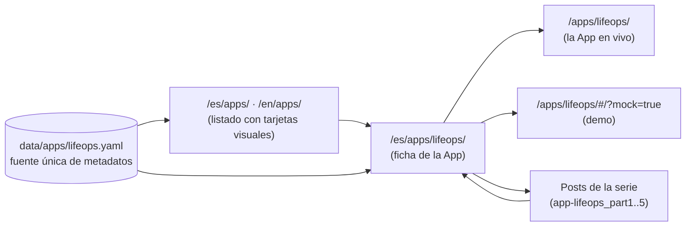

# Especificación Técnica SDD: Sistema de Fichas de Apps (`apps-showcase`)

> **ID de Especificación:** `SPEC-PORTAL-APPS-SHOWCASE`
> **Versión:** `1.0.0`
> **Estado:** `DRAFT` — pendiente de validación del usuario antes del Hito 1.3
> **Ámbito:** Portal Hugo (`content/`, `layouts/`, `data/`, `assets/` o `static/css/`)
> **Origen:** Petición del usuario (2026-10-24) + ADR-007

---

## 1. Objetivo

Convertir la sección **Apps** del portal en un escaparate de producto profesional y mantenible:

1. **Una ficha dedicada por App** (`/es/apps/<slug>/` y `/en/apps/<slug>/`) con objetivos, especificaciones de diseño, tecnologías, enlaces a posts y **historial evolutivo de versiones**.
2. **Un listado `/apps/` con tarjetas visuales** (captura, descripción, estado, versión) al estilo de las tarjetas de packs y artículos, que llevan a la ficha.
3. **Los posts de referencia enlazan a la ficha** para que el lector siga la evolución de la App.
4. Aplicable a las 7 Apps activas y a **todas las Apps futuras** con el mismo esfuerzo mínimo (añadir 1 fichero de datos + 2 páginas cortas + 1 captura).

### No-objetivos
- No se modifica el código de ninguna App (las Apps siguen sirviéndose desde `static/apps/<slug>/` o su proxy).
- No se cambian las URLs de las Apps (`/apps/lifeops/`, `/games/snake/`, etc.).

---

## 2. Arquitectura de Información



### 2.1 Separación de URLs (sin colisión)

| URL | Qué es | Origen |
| :--- | :--- | :--- |
| `/es/apps/` · `/en/apps/` | Listado de Apps | `content/{es,en}/apps/_index.md` + `layouts/apps/list.html` |
| `/es/apps/<slug>/` · `/en/apps/<slug>/` | Ficha de la App | `content/{es,en}/apps/<slug>/index.md` + `layouts/apps/single.html` |
| `/apps/<slug>/` (sin idioma) | La App ejecutable | `static/apps/<slug>/` o proxy en `static/_redirects` |

> Como `defaultContentLanguageInSubdir: true`, las páginas Hugo siempre llevan prefijo de idioma y **nunca colisionan** con `static/apps/<slug>/`.

---

## 3. Modelo de Datos — Fuente Única por App

**Fichero:** `data/apps/<slug>.yaml` (bilingüe, sin duplicar estructura por idioma).
La ficha y la tarjeta se renderizan **solo** desde este fichero; el `index.md` de cada idioma contiene únicamente front matter mínimo y, opcionalmente, texto libre adicional.

```yaml
# data/apps/lifeops.yaml — contrato (todos los campos marcados * son obligatorios)
slug: lifeops                       # * = nombre de carpeta en static/apps y content/*/apps
order: 10                           # * orden en el listado (menor = primero)
tier: flagship                      # * flagship | b2b | lab   (sección del listado)
status: live                        # * live | beta | maintenance | frozen | incubating
icon: "🚀"                          #   fallback si no hay captura
cover: cover.png                    # * captura (en el page bundle content/<lang>/apps/<slug>/)
app_url: /apps/lifeops/             # * URL de la App en vivo
demo_url: /apps/lifeops/#/?mock=true  #   opcional (Dual-Mode)
source_spec: specs/apps/lifeops/spec.md  # * trazabilidad SDD (no se publica como enlace)
current_version: v1.0.0             # * debe coincidir con la última entrada "released" de releases
title:      { es: "LifeOps", en: "LifeOps" }                                   # *
tagline:    { es: "...", en: "..." }                                           # * 1 frase (tarjeta)
summary:    { es: "...", en: "..." }                                           # * 2-3 frases (ficha + SEO description)
objectives:                                                                    # * 3-6 items
  - { es: "...", en: "..." }
features:                                                                      #   lista de capacidades
  - { icon: "🏃", es: "...", en: "..." }
design:                                                                        # * especificaciones de diseño
  architecture: { es: "...", en: "..." }
  principles:   [ { es: "...", en: "..." } ]
  diagram: |                                                                   #   mermaid opcional
    flowchart LR ...
tech:                                                                          # * agrupado por capa
  - { layer: frontend, items: ["React 19", "Vite 8", "React Router 7"] }
  - { layer: backend,  items: ["FastAPI", "Pydantic v2"] }
  - { layer: data,     items: ["Supabase PostgreSQL (schema lifeops)"] }
  - { layer: infra,    items: ["Netlify", "Render"] }
posts:                                                                         # * ≥1 (Invariante App ⇔ Post)
  - { slug: app-lifeops_part1_arquitectura_backend, part: 1 }
related_products: []                                                           #   Lemon Squeezy (checkout_url + data-product-name)
releases:                                                                      # * historial evolutivo, más reciente primero
  - version: v1.0.0
    date: 2026-09-19
    state: released                 # released | planned
    type: release                   # release | feature | fix | security | infra | ux
    title:   { es: "...", en: "..." }
    changes: [ { es: "...", en: "..." } ]
```

### 3.1 Reglas de validación (build-time)
El layout **debe fallar el build** (`errorf`) si:
- Falta un campo obligatorio `*`.
- `current_version` no coincide con la primera entrada `state: released` de `releases`.
- Algún `posts[].slug` no resuelve a una página publicada en el idioma actual (`site.GetPage`).
- No existe `cover` en el page bundle.

> Esto convierte el Invariante `App ⇔ Post` (Constitución Art. 7) en una comprobación automática de `hugo --gc --minify`.

---

## 4. Ficha de App — `layouts/apps/single.html`

Secciones en este orden (todas generadas desde `data/apps/<slug>.yaml`):

| # | Sección | Contenido |
| :-: | :--- | :--- |
| 1 | **Hero** | Captura grande, título, tagline, badge de `status`, badge `current_version`, botones **Abrir App** · **Probar demo** (si `demo_url`) · **Leer la serie** (ancla a §6). |
| 2 | **Objetivos** | Lista `objectives`. |
| 3 | **Qué hace** | Grid `features`. |
| 4 | **Especificaciones de diseño** | `design.architecture`, `design.principles`, diagrama Mermaid (reutiliza el soporte Mermaid ya existente del portal). |
| 5 | **Tecnologías** | Chips agrupados por `layer`. |
| 6 | **Artículos de referencia** | Tarjetas de los `posts` (portada, título, fecha) resueltas con `site.GetPage` en el idioma actual. |
| 7 | **Historial evolutivo** | Timeline vertical de `releases` (versión, fecha, tipo con icono, título, cambios). Las `planned` se muestran como "Próximamente". |
| 8 | **CTA** | `related_products` (Lemon Squeezy, con atributos de telemetría existentes) o, si vacío, la newsletter del footer. |

**SEO:** `title` = `"<title> — App | Datalaria"`, `description` = `summary`, OpenGraph con `cover` (reutiliza `partials/templates/opengraph.html`). Hreflang ES/EN automático por traducción Hugo (mismo `translationKey`).

---

## 5. Listado — `layouts/apps/list.html` + Tarjeta `partials/app-card.html`

- Agrupado por `tier` en este orden: **Apps destacadas** (`flagship`), **Suites B2B** (`b2b`), **Laboratorio & Arcade** (`lab`). Grupos vacíos no se renderizan.
- Dentro de cada grupo, ordenado por `order`.
- Apps con `status: incubating` **no se listan** (Constitución Art. 7).

**Tarjeta (inspirada en `executive-product-card` y las tarjetas de posts):**

| Zona | Contenido |
| :--- | :--- |
| Imagen | `cover` 16:10 con `object-fit: cover`, procesada con Hugo Image Processing (`.Fill "800x500 webp"`) y `loading="lazy"`. |
| Badges | `status` + `current_version`. |
| Texto | `title`, `tagline`, 3 chips de tecnología principales. |
| Acción principal | Toda la tarjeta enlaza a la **ficha**. |
| Acción secundaria | Botón pequeño **"Abrir App ↗"** directo a `app_url`. |

**Estilos:** CSS dedicado `static/css/apps-showcase.css` (o en `assets/` si se usa Hugo Pipes), reutilizando las variables del tema PaperMod (`--entry`, `--border`, `--primary`, `--secondary`, `--tertiary`) para soportar modo claro/oscuro. Se retiran las clases antiguas `.app-grid/.app-card` de `static/css/custom.css` cuando ya no se usen.

---

## 6. Enlaces desde los Posts — Shortcode `app-ref`

Para no repetir HTML en cada post y mantener los enlaces actualizados:

```markdown

```

Renderiza una caja compacta (icono/captura mini, título, versión actual, "Ver ficha y evolución →", "Abrir App ↗"), leyendo de `data/apps/<slug>.yaml`.

**Regla de edición de posts:**
- Insertar el shortcode **una vez al inicio** (sustituyendo o junto al bloque `> [!TIP] Prueba la aplicación en vivo`) y **una vez en la sección de recursos final**.
- No se elimina ningún enlace existente a la App; solo se añade la ficha.
- Cambio idéntico en ES y EN.

---

## 7. Contenido por App

| Fichero | Contenido |
| :--- | :--- |
| `data/apps/<slug>.yaml` | Todos los metadatos (§3). |
| `content/es/apps/<slug>/index.md` | Front matter: `title`, `app: <slug>`, `translationKey: app-<slug>`, `layout: single` (implícito por sección). Cuerpo opcional. |
| `content/en/apps/<slug>/index.md` | Idem en inglés. |
| `content/{es,en}/apps/<slug>/cover.png` | Captura de la App (mín. 1600×1000, recomendada 16:10). |

> **Capturas:** las proporciona el autor o se generan desde la App en modo demo. Hasta tenerlas, el layout usa `icon` como placeholder **solo si `status: frozen`**; para el resto la captura es obligatoria.

---

## 8. Plan de Implementación

| Hito | Alcance | Gate |
| :--- | :--- | :--- |
| **1.3** | Infraestructura: `layouts/apps/list.html`, `layouts/apps/single.html`, `partials/app-card.html`, shortcode `app-ref`, CSS, validaciones §3.1. Migración del listado para que las 7 Apps actuales sigan apareciendo (las que aún no tienen ficha conservan temporalmente la tarjeta legacy vía bandera). | `hugo --gc --minify` = 0 · `/es/apps/` y `/en/apps/` muestran las 7 Apps · sin enlaces rotos. |
| **1.4** | LifeOps: `data/apps/lifeops.yaml`, fichas ES/EN, captura, shortcode en los 5 posts × 2 idiomas. | Ficha visible en ambos idiomas · timeline con v0.1.0 → v1.0.x · los 10 posts enlazan a la ficha. |
| **2.x / 3.x** | Resto de Apps: cada hito de migración incluye su `data/apps/<slug>.yaml`, fichas y enlaces en sus posts. | Igual que 1.4 para cada App. |

---

## 9. Criterios de Aceptación

- [ ] `hugo --gc --minify` termina con código `0` y falla si se rompe cualquier regla de §3.1.
- [ ] `/es/apps/` y `/en/apps/` tienen paridad exacta de Apps y grupos.
- [ ] Cada tarjeta enlaza a una ficha existente y su botón "Abrir App" a una URL que responde `200`.
- [ ] Cada ficha muestra los 8 bloques de §4 (los opcionales se ocultan si no hay datos).
- [ ] Lighthouse móvil de `/es/apps/` ≥ 90 en Performance y Accessibility (imágenes WebP + lazy).
- [ ] Ninguna URL de App existente cambia.
