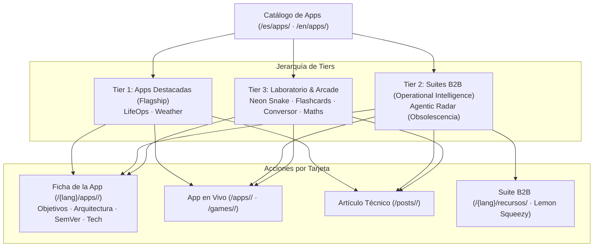

# SPEC-PORTAL: Catálogo de Aplicaciones & Escaparate Tecnológico (`apps-showcase`)

> **Identificador:** `SPEC-PORTAL`  
> **Versión:** `v1.1.0`  
> **Fecha:** `2026-10-26` (Hito 3.2 SDD)  
> **Estado:** `APROBADO & EN PRODUCCIÓN`  
> **Ámbito:** Portal Editorial Hugo (`content/{es,en}/apps/`, `layouts/apps/`, `layouts/partials/index_profile.html`, `data/apps/`, `assets/css/extended/apps-showcase.css`, `assets/css/extended/home-portal.css`)  
> **Normativa:** [specs/_constitution.md](../../specs/_constitution.md) (Artículos 7 y 8) y [specs/DECISIONS.md](../../specs/DECISIONS.md) (ADR-007, ADR-009, ADR-010, ADR-011)

---

## 1. RESUMEN EJECUTIVO Y OBJETIVOS

El **Portal de Aplicaciones de Datalaria** (`/es/apps/` y `/en/apps/`) constituye el escaparate tecnológico interactivo que conecta el contenido editorial del blog con las soluciones de software ejecutables y los productos B2B comercializados a través de Lemon Squeezy.

### Objetivos Fundamentales:
1. **Jerarquización por Tiers de Valor:** Estructurar las 7 aplicaciones activas en 3 niveles de valor técnico y de negocio:
   - **Tier 1: Apps Destacadas (`flagship`):** Aplicaciones full-stack con arquitecturas complejas y persistencia en la nube (`LifeOps`, `El Tiempo / Weather`).
   - **Tier 2: Suites B2B & Inteligencia Operacional (`b2b`):** Dashboards ejecutivos y herramientas cuantitativas orientadas a comités de dirección y monetizadas con Lemon Squeezy (`Radar de Obsolescencia / Agentic Radar`).
   - **Tier 3: Laboratorio & Arcade (`lab`):** Experimentos de navegador, utilidades científicas y arcades (`Neon Snake`, `Flashcards AI`, `Conversor de Unidades`, `Matemáticas Interactivas`).
2. **Navegación Multiacción en Tarjeta:** Cada tarjeta del catálogo ofrece acceso directo y diferenciado:
   - **Clic en Tarjeta / Título / Portada:** Navega a la **Ficha Técnica y Evolución** (`/{lang}/apps/<slug>/`).
   - **Acción Primaria:** Botón `"Ver Ficha & Evolución →"`.
   - **Acción Ejecutable:** Botón `"Abrir App ↗"` (o `"Jugar ↗"`).
   - **Acción Editorial:** Botón secundario `"Leer Post"` hacia el artículo tutorial en el blog.
   - **Acción B2B:** Botón destacado `"Suite B2B ⚡"` hacia los paquetes descargables (`/{lang}/recursos/`).
3. **Paridad Bilingüe Estricta (ES/EN):** Simetría completa de rutas, metadatos, traducciones y enlaces entre el catálogo en español e inglés.
4. **Mantenibilidad Data-Driven (SDD):** Toda la información emana de `data/apps/<slug>.yaml`. Crear o actualizar una app requiere únicamente 1 fichero YAML y los bundles de contenido sin tocar plantillas HTML.

---

## 2. ARQUITECTURA DE INFORMACIÓN Y ENRUTAMIENTO



### Tabla de Rutas Canónicas del Ecosistema

| # | Slug | Nombre (ES / EN) | Tier | URL App | Ficha Técnica | Post Principal | Lemon Squeezy |
| :-: | :--- | :--- | :--- | :--- | :--- | :--- | :--- |
| 1 | `lifeops` | LifeOps | `flagship` | `/apps/lifeops/` | `/{lang}/apps/lifeops/` | `app-lifeops_part1_arquitectura_backend` | — |
| 2 | `obs-management` | Radar de Obsolescencia / Agentic Radar | `b2b` | `/apps/obs-management/` | `/{lang}/apps/obs-management/` | `obs_parte1_intro` | `/es/recursos/` |
| 3 | `weather` | El Tiempo / Weather Service AI | `flagship` | `/apps/weather/` | `/{lang}/apps/weather/` | `app-openweather_part1_backend` | — |
| 4 | `snake` | Neon Snake | `lab` | `/games/snake/` | `/{lang}/apps/snake/` | `game_snake` | — |
| 5 | `flashcards` | Flashcards AI | `lab` | `/apps/flashcards/` | `/{lang}/apps/flashcards/` | `app_flashcards` | — |
| 6 | `conversor` | Conversor de Unidades / Unit Converter | `lab` | `/apps/conversor/` | `/{lang}/apps/conversor/` | `app_conversor_unidades` | — |
| 7 | `maths` | Matemáticas Interactivas / Interactive Maths | `lab` | `/apps/maths/` | `/{lang}/apps/maths/` | `founderz-programando-chatGPT` | — |

---

## 3. MODELO DATA-DRIVEN Y CONTRATO DE METADATOS

Cada aplicación se define en `data/apps/<slug>.yaml` con los siguientes campos contractuales:

```yaml
slug: <string>              # Identificador canónico único
order: <integer>            # 10, 20, 30... Orden de renderizado dentro del tier
tier: flagship | b2b | lab  # Tier de jerarquía
status: live | beta | frozen # Estado operativo
icon: <emoji>               # Icono representativo
cover: cover.png            # Portada nativa 16:10 (1280x800) en el page bundle
app_url: <string>           # URL pública de ejecución
demo_url: <string>          # URL opcional del modo sandbox/demo
source_spec: <string>       # Ruta a la spec SDD (specs/apps/<slug>/spec.md)
current_version: <string>   # Coincide con la primera release "released"
title: { es: "...", en: "..." }
tagline: { es: "...", en: "..." }
summary: { es: "...", en: "..." }
objectives: [ { es: "...", en: "..." } ]
features: [ { icon: "...", es: "...", en: "..." } ]
design:
  architecture: { es: "...", en: "..." }
  principles: [ { es: "...", en: "..." } ]
  diagram: |
    flowchart LR ...
tech: [ { layer: "...", items: [...] } ]
posts: [ { slug: { es: "...", en: "..." }, part: <int> } ]
related_products: [ { name: "...", checkout_url: "..." } ]
releases: [ { version: "...", date: "...", state: "released", type: "...", title: {...}, changes: [...] } ]
```

---

## 4. SISTEMA DE PORTADAS Y COMPONENTES VISUALES

1. **Relación de Aspecto Fija 16:10:**
   - Todas las capturas `cover.png` tienen dimensiones maestras **1280x800 píxeles**.
   - En las tarjetas del catálogo (`layouts/partials/app-card.html`), Hugo procesa la miniatura mediante `.Fill "800x500 webp"`. Al compartir exactamente la relación 1.6 (16:10), el recorte es de cero píxeles, garantizando que no existan barras negras ni cortes de interfaz.
   - En la ficha individual (`layouts/apps/single.html`), la portada se escala fluidamente mediante `.Resize "1200x"`.
2. **Tokens de Color PaperMod:**
   - La interfaz utiliza tokens semánticos del tema base (`--theme`, `--primary`, `--secondary`, `--border`, `--entry`), garantizando compatibilidad nativa con modo claro y modo oscuro.
3. **Píldoras de Navegación por Tier:**
   - La cabecera del catálogo incluye accesos directos por ancla (`#tier-flagship`, `#tier-b2b`, `#tier-lab`) para que el usuario explore directamente el área de su interés.
4. **Tarjetas en Miniatura en el Home Index (`03 / ECOSISTEMA · Apps & Experimentos`):**
   - El bloque `#apps` de la portada (`layouts/partials/index_profile.html`) renderiza las 7 aplicaciones del ecosistema en formato tarjeta compacta en miniatura (`.dlh-app`) sobre una cuadrícula flexible de **4 columnas en escritorio** (4 tarjetas en la primera fila y 3 centradas en la segunda), reutilizando dinámicamente la imagen `cover.png` (`.Fill "400x250 webp"`) del page bundle de cada app (`content/{es,en}/apps/<slug>/cover.png`) con dimensiones en miniatura (`148x92px`, proporción `16:10` exacta sin recortes).
   - Cada miniatura ofrece doble acción explícita:
     1. **Acción Ejecutable Primaria (`.dlh-app-btn--primary`):** Enlace directo a la aplicación en vivo (`/apps/<slug>/` o `/games/snake/`).
     2. **Acción de Ficha Asociada (`.dlh-app-btn--secondary` + enlace en portada/título):** Enlace directo a la página dedicada de objetivos, arquitectura y evolución (`/{lang}/apps/<slug>/`).

---

## 5. VALIDACIONES Y GATES DE CALIDAD (BUILD-TIME)

El compilador Hugo (`hugo --renderToMemory`) actúa como gate determinista automático:
- **Validación de Ficha:** Falla con `errorf` si falta cualquier campo obligatorio del contrato.
- **Validación SemVer:** Falla si `current_version` no coincide con la primera release marcada como `state: released`.
- **Validación de Posts:** Falla si algún `posts[].slug` no resuelve a un artículo real publicado en el idioma activo.
- **Validación de Enlaces:** Todos los enlaces a fichas, posts, apps y recursos responden `200 OK`.
