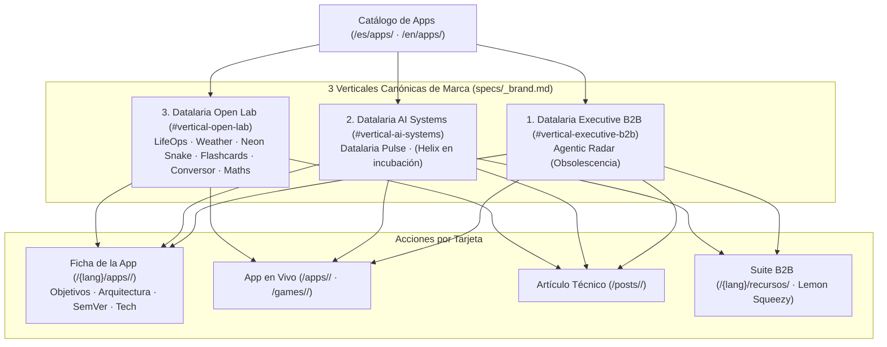

# SPEC-PORTAL: Catálogo de Aplicaciones & Escaparate Tecnológico (`apps-showcase`)

> **Identificador:** `SPEC-PORTAL`  
> **Versión:** `v1.3.0`  
> **Fecha:** `2026-11-24` (Hito 9.4 — Despliegue Visual 3 Verticales de Marca `specs/_brand.md` & `ADR-034`)  
> **Estado:** `APROBADO & EN PRODUCCIÓN`  
> **Ámbito:** Portal Editorial Hugo (`content/{es,en}/apps/`, `layouts/apps/`, `layouts/partials/index_profile.html`, `data/apps/`, `assets/css/extended/apps-showcase.css`, `assets/css/extended/home-portal.css`)  
> **Normativa:** [specs/_constitution.md](../../specs/_constitution.md) (Artículos 7, 8 y 10), [specs/_brand.md](../../specs/_brand.md) y [specs/DECISIONS.md](../../specs/DECISIONS.md) (ADR-007, ADR-009, ADR-010, ADR-011, ADR-018, ADR-034)

---

## 1. RESUMEN EJECUTIVO Y OBJETIVOS

El **Portal de Aplicaciones de Datalaria** (`/es/apps/` y `/en/apps/`) constituye el escaparate tecnológico interactivo que conecta el contenido editorial del blog con las soluciones de software ejecutables y los productos B2B comercializados a través de Lemon Squeezy.

### Objetivos Fundamentales:
1. **Jerarquización por 3 Verticales Canónicas de Marca (`specs/_brand.md` & `ADR-034`):**
   Estructurar el catálogo público en 3 verticales ordenadas estratégicamente por precedencia C-Level:
   - **Vertical 1: Datalaria Executive B2B (`executive_b2b` — `#vertical-executive-b2b`):** Dashboards ejecutivos y herramientas cuantitativas orientadas a comités de dirección, operaciones y mitigación de riesgos de suministro (`Radar de Obsolescencia / Agentic Radar`). Motor principal de ingresos B2B.
   - **Vertical 2: Datalaria AI Systems (`ai_systems` — `#vertical-ai-systems`):** Sistemas agénticos en producción, Content Ops as Code y herramientas para equipos de ingeniería y constructores de IA (`Datalaria Pulse`, y en incubación `Datalaria Helix`). Motor de diferenciación y escala SaaS/Pro.
   - **Vertical 3: Datalaria Open Lab (`open_lab` — `#vertical-open-lab`):** Sistemas operativos personales (`LifeOps`), inteligencia ambiental (`Weather`), utilidades científicas y simuladores arcade (`Neon Snake`, `Flashcards AI`, `Conversor de Unidades`, `Matemáticas Interactivas`). Escaparate de ingeniería, viralidad orgánica y backlinks.
2. **Navegación Multiacción en Tarjeta:** Cada tarjeta del catálogo ofrece acceso directo y diferenciado:
   - **Clic en Tarjeta / Título / Portada:** Navega a la **Ficha Técnica y Evolución** (`/{lang}/apps/<slug>/`).
   - **Acción Primaria:** Botón `"Ver Ficha & Evolución →"`.
   - **Acción Ejecutable:** Botón `"Abrir App ↗"` (o `"Jugar ↗"`).
   - **Acción Editorial:** Botón secundario `"Leer Post"` hacia el artículo tutorial en el blog.
   - **Acción B2B:** Botón destacado `"Suite B2B ⚡"` hacia los paquetes descargables (`/{lang}/recursos/`).
3. **Paridad Bilingüe Estricta (ES/EN):** Simetría completa de rutas, metadatos, traducciones y enlaces entre el catálogo en español e inglés.
4. **Mantenibilidad Data-Driven (SDD):** Toda la información emana de `data/apps/<slug>.yaml`. Crear o actualizar una app requiere únicamente 1 fichero YAML y los bundles de contenido sin tocar plantillas HTML. Prohibido duplicar versiones en fallbacks hardcoded de plantillas (Constitución Art. 8.2).
5. **Cero Rotura SEO y Anclas de Compatibilidad (`INV-TAX-1`):** Se mantienen anclas de alias `#tier-b2b`, `#tier-flagship` y `#tier-lab` para preservar enlaces entrantes y compatibilidad retroactiva.

---

## 2. ARQUITECTURA DE INFORMACIÓN Y ENRUTAMIENTO



### Tabla de Rutas Canónicas del Ecosistema

| # | Slug | Nombre (ES / EN) | Brand Vertical | Tier (Legacy) | URL App | Ficha Técnica | Post Principal | Lemon Squeezy |
| :-: | :--- | :--- | :--- | :--- | :--- | :--- | :--- | :--- |
| 1 | `obs-management` | Radar de Obsolescencia / Agentic Radar | `executive_b2b` | `b2b` | `/apps/obs-management/` | `/{lang}/apps/obs-management/` | `obs_parte1_intro` | `/es/recursos/` |
| 2 | `pulse` | Datalaria Pulse | `ai_systems` | `b2b` | `/apps/pulse/` | `/{lang}/apps/pulse/` | `app-pulse-governance` | `/es/recursos/` |
| 3 | `lifeops` | LifeOps | `open_lab` | `flagship` | `/apps/lifeops/` | `/{lang}/apps/lifeops/` | `app-lifeops_part1_arquitectura_backend` | — |
| 4 | `weather` | El Tiempo / Weather Service AI | `open_lab` | `flagship` | `/apps/weather/` | `/{lang}/apps/weather/` | `app-openweather_part1_backend` | — |
| 5 | `snake` | Neon Snake | `open_lab` | `lab` | `/games/snake/` | `/{lang}/apps/snake/` | `game_snake` | — |
| 6 | `flashcards` | Flashcards AI | `open_lab` | `lab` | `/apps/flashcards/` | `/{lang}/apps/flashcards/` | `app_flashcards` | — |
| 7 | `conversor` | Conversor de Unidades / Unit Converter | `open_lab` | `lab` | `/apps/conversor/` | `/{lang}/apps/conversor/` | `app_conversor_unidades` | — |
| 8 | `maths` | Matemáticas Interactivas / Interactive Maths | `open_lab` | `lab` | `/apps/maths/` | `/{lang}/apps/maths/` | `founderz-programando-chatGPT` | — |

---

## 3. MODELO DATA-DRIVEN Y CONTRATO DE METADATOS

Cada aplicación se define en `data/apps/<slug>.yaml` con los siguientes campos contractuales:

```yaml
slug: <string>              # Identificador canónico único
order: <integer>            # 10, 20, 30... Orden de renderizado dentro de la vertical
brand_vertical: executive_b2b | ai_systems | open_lab  # * Vertical de marca canónica (specs/_brand.md)
tier: flagship | b2b | lab  # Tier de jerarquía (mantenido por compatibilidad histórica)
status: live | active | beta | frozen | incubating # Estado operativo (incubating = oculto de catálogo público)
icon: <emoji>               # Icono representativo
cover: cover.png            # Portada nativa 16:10 (1280x800) en el page bundle
app_url: <string>           # URL pública de ejecución
demo_url: <string>          # URL opcional del modo sandbox/demo
source_spec: <string>       # Ruta a la spec SDD (specs/apps/<slug>/spec.md)
current_version: <string>   # Coincide con la primera release "released" (Fuente Única)
title: { es: "...", en: "..." }
tagline: { es: "...", en: "..." }
summary: { es: "...", en: "..." }
objectives: [ { es: "...", en: "..." } ]
features: [ { icon: "...", es: "...", en: "..." } ]
design:
  architecture: { es: "...", en: "..." }
  principles: [ { es: "...", en: "..." } ]
  diagram: |
    flowchart LR ...
tech: [ { layer: "...", items: [...] } ]
posts: [ { slug: { es: "...", en: "..." }, part: <int> } ]
related_products: [ { name: "...", checkout_url: "..." } ]
releases: [ { version: "...", date: "...", state: "released", type: "...", title: {...}, changes: [...] } ]
```

### 3.1 Regla de Fallback Determinista desde `tier`
Para garantizar máxima resiliencia arquitectónica si en algún fichero YAML faltase temporalmente el campo `brand_vertical`, las plantillas (`layouts/apps/list.html`, `layouts/partials/app-card.html`, `layouts/partials/index_profile.html`) implementan la siguiente regla determinista:
1. Si `.brand_vertical` está presente y es válido, se adopta directamente.
2. Si `.brand_vertical` está ausente:
   - Si `slug == "obs-management"` o (`tier == "b2b"` y `slug` no es `pulse` ni `helix`) $\rightarrow$ `executive_b2b`.
   - Si `slug == "pulse"` o `slug == "helix"` $\rightarrow$ `ai_systems`.
   - Para cualquier otra aplicación (`lifeops`, `weather`, `snake`, `flashcards`, `conversor`, `maths`, `reading`, o `tier in ["flagship", "lab"]`) $\rightarrow$ `open_lab`.

---

## 4. SISTEMA DE PORTADAS Y COMPONENTES VISUALES

1. **Relación de Aspecto Fija 16:10:**
   - Todas las capturas `cover.png` tienen dimensiones maestras **1280x800 píxeles**.
   - En las tarjetas del catálogo (`layouts/partials/app-card.html`), Hugo procesa la miniatura mediante `.Fill "800x500 webp"`. Al compartir exactamente la relación 1.6 (16:10), el recorte es de cero píxeles, garantizando que no existan barras negras ni cortes de interfaz.
   - En la ficha individual (`layouts/apps/single.html`), la portada se escala fluidamente mediante `.Resize "1200x"`.
2. **Tokens de Color PaperMod:**
   - La interfaz utiliza tokens semánticos del tema base (`--theme`, `--primary`, `--secondary`, `--border`, `--entry`), garantizando compatibilidad nativa con modo claro y modo oscuro.
3. **Píldoras de Navegación por Vertical de Marca:**
   - La cabecera del catálogo incluye accesos directos por ancla en el orden canónico:
     - `#vertical-executive-b2b` (💼 Executive B2B)
     - `#vertical-ai-systems` (🤖 AI Systems)
     - `#vertical-open-lab` (🧪 Open Lab)
   - Dispone de anclas invisibles de compatibilidad (`#tier-b2b`, `#tier-flagship`, `#tier-lab`) para garantizar que enlaces externos o marcadores históricos no sufran rotura 404 (`INV-TAX-1`).
4. **Tarjetas en Miniatura en el Home Index (`03 / ECOSISTEMA · Apps & Sistemas`):**
   - El bloque `#apps` de la portada (`layouts/partials/index_profile.html`) prioriza la jerarquía C-Level:
     1. Precedencia visual: 1.° `executive_b2b` (`obs-management`), 2.° `ai_systems` (`pulse`), 3.° `open_lab` (`lifeops`, `weather`, `snake`, `flashcards`, `conversor`, `maths`).
     2. Filtro interactivo por pestañas (`.dlh-app-tabs`): 4 botones alineados con las verticales (`Todas las Apps / All Apps` activa por defecto, `💼 Executive B2B`, `🤖 AI Systems`, `🧪 Open Lab`) que conmutan dinámicamente las tarjetas mediante `data-tier`.
   - Renderiza las 8 aplicaciones públicas del ecosistema en formato tarjeta compacta en miniatura (`.dlh-app`) sobre una cuadrícula flexible de **4 columnas en escritorio** (4 tarjetas en la primera fila y 4 en la segunda), reutilizando dinámicamente la imagen `cover.png` (`.Fill "400x250 webp"`) del page bundle de cada app (`content/{es,en}/apps/<slug>/cover.png`) con dimensiones en miniatura (`148x92px`, proporción `16:10` exacta sin recortes).
   - Cada miniatura ofrece doble acción explícita:
     1. **Acción Ejecutable Primaria (`.dlh-app-btn--primary`):** Enlace directo a la aplicación en vivo (`/apps/<slug>/` o `/games/snake/`).
     2. **Acción de Ficha Asociada (`.dlh-app-btn--secondary` + enlace en portada/título):** Enlace directo a la página dedicada de objetivos, arquitectura y evolución (`/{lang}/apps/<slug>/`).
5. **Tarjetas de Suite en el Catálogo de Recursos B2B (`layouts/partials/recursos_catalog.html`, `assets/css/extended/recursos.css`):**
   - Cada tarjeta de Suite en `#suites-quick-grid` (`#suite-01`, `#suite-02`, `#suite-03`) y en el banner contextual `#suite-contextual-banner` ofrece la misma triada de acciones que los packs individuales:
     1. **Botón `Detalles ℹ️` (`Details ℹ️`):** Abre el modal interactivo (`openModal('suite-01')`) mostrando la vista previa visual compuesta (`suite-01-preview-es.png` / `suite-01-preview-en.png`), entregables, características clave, enlace al artículo técnico y CTA de compra.
     2. **Botón `Artículo técnico 📖` (`Technical Article 📖`):** Enlaza directamente al Post Pilar Maestro de la Suite (`/es/posts/estrategia-corporativa-mba-framework-cuantitativo/` y `/en/posts/corporate-strategy-mba-quantitative-framework/` para Suite 01; indicador `Artículo próximamente` / `Article coming soon` cuando el post pilar aún no está publicado).
     3. **Botón `Comprar Suite →` (`Buy Suite →`):** Enlace directo al checkout embebido de Lemon Squeezy con precio actual y precio original tachado (`19€` vs `28€` en Suite 01).

---

## 5. VALIDACIONES Y GATES DE CALIDAD (BUILD-TIME)

El compilador Hugo (`hugo --renderToMemory`) actúa como gate determinista automático:
- **Validación de Ficha:** Falla con `errorf` si falta cualquier campo obligatorio del contrato.
- **Validación SemVer:** Falla si `current_version` no coincide con la primera release marcada como `state: released`.
- **Validación de Posts:** Falla si algún `posts[].slug` no resuelve a un artículo real publicado en el idioma activo.
- **Validación de Enlaces:** Todos los enlaces a fichas, posts, apps y recursos responden `200 OK`.

---

## 6. HELIX RELEASE RADAR: NOVEDADES EVOLUTIVAS DE APPS (`dlh-releases`)

### 6.1 Propósito y Ubicación
El componente **Helix Release Radar (`dlh-releases`)** se integra en la base de la **Brújula del Descubrimiento (`.dlh-compass`)** en la página de inicio (`index_profile.html`). Su objetivo es anunciar de forma sutil y elegante las últimas mejoras y versiones lanzadas de las aplicaciones activas sin canibalizar el espacio visual ni la atención de las 3 tarjetas de publicaciones del blog (`Más leído`, `Última publicación`, `Aleatorio`).

### 6.2 Invariantes de Dominio
- **`INV-PORTAL-REL-1 (Filtro de Embargo y Estado Público)`:** Solo se procesan ficheros en `site.Data.apps` cuyo `status` sea `"live"` o `"active"`. Quedan estrictamente excluidas las apps con `status: "incubating"`, `draft: true` o cuya página en `content/{es,en}/apps/<slug>/` esté en borrador (`draft: true`).
- **`INV-PORTAL-REL-2 (Ventana Dinámica de 14 Días + Fallback Resiliente)`:** Se consideran únicamente releases con `state: "released"` cuya fecha esté comprendida en los últimos 14 días respecto a la fecha actual. En tiempo de ejecución en el cliente (JS), se valida la ventana de 14 días (`(ahora - fecha_release) <= 14 * 86400000 ms`). Si en algún periodo futuro transcurren más de 14 días sin nuevos lanzamientos, el componente activa un fallback resiliente que muestra la release más reciente del ecosistema, garantizando que el radar nunca quede vacío ni roto.
- **`INV-PORTAL-REL-3 (Estado Minimizado por Defecto y SEO Crawlable)`:** La barra se presenta minimizada por defecto ocupando una sola línea compacta de 44px (`#dlh-rel-drawer` con atributo `hidden` y `aria-expanded="false"`). Todos los enlaces hacia las Fichas Técnicas (`/{lang}/apps/<slug>/`) y las Apps existen estáticamente en el código HTML para garantizar indexación completa por crawlers y lectores de pantalla.
- **`INV-PORTAL-REL-4 (Doble CTA Exclusivo hacia Ficha y App)`:** Al desplegar el cajón de mejoras, la caja de acciones ofrece **únicamente dos botones**:
  1. **Primario:** `Probar App ↗` / `Open App ↗` (o `Jugar ↗` / `Play ↗` para `snake`), con enlace directo a `.app_url`.
  2. **Secundario:** `📋 Ficha & Especificaciones →` / `📋 App Specs & Changelog →`, con enlace directo a `/{lang}/apps/<slug>/`. No se incluye enlace directo al artículo del blog en este cajón para evitar desactualizaciones y concentrar el tráfico en la ficha técnica completa.

### 6.3 Especificación del Flujo de Datos y Plantilla
1. **Colección Data-Driven (Build-Time):**
   - Hugo recorre `site.Data.apps` filtrando por `status in ["live", "active"]`.
   - Extrae la última release con `state: "released"` de cada app.
   - Ordena las releases por `date` descendente y por `order` ascendente como desempate.
   - Exporta el dataset JSON embebido en `<script type="application/json" id="dlh-releases-data">`.
2. **Interactividad Client-Side (Zero Dependencies):**
   - El script en `index_profile.html` hidrata la primera release en la barra minimizada `#dlh-rel-bar`.
   - Permite rotar entre las releases de la ventana con los controles `#dlh-rel-prev` y `#dlh-rel-next` (`‹ 1/N ›`).
   - El botón `#dlh-rel-toggle` y el cuerpo de la barra conmutan el estado del cajón `#dlh-rel-drawer` (`aria-expanded="true/false"`), alternando el texto entre `✨ Ver mejoras ▾` / `✨ What's new ▾` y `Ocultar ▴` / `Hide ▴`.
   - La fila de píldoras inferiores `#dlh-rel-chips` permite saltar directamente a cualquier release de los últimos 14 días.
   - Telemetría GA4: emite los eventos `home_release_radar_toggle` y `home_release_radar_select`.
