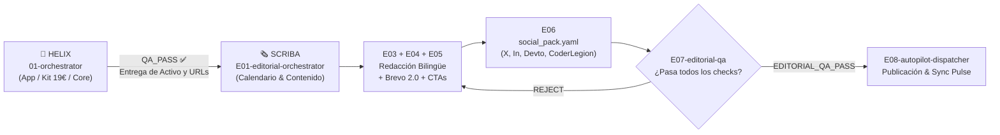

# 🗞️ Datalaria Scriba — Escuadrón Editorial & Growth de 8 Agentes (`specs/squad-editorial/`)

> **Fuente Única de Verdad (`INV-SCRIBA-4` / `ADR-020`):** Este directorio contiene las definiciones canónicas (`AGENT_SPEC`) de los **8 roles especializados** de **Datalaria Scriba** (comercializable a futuro como *Datalaria Pulse Scriba*). Cualquier adaptador para herramientas específicas (`.agents/squad-editorial/`, `.claude/agents/`, `.cursor/rules/`) se genera automáticamente mediante `python -m ops.helix.build_adapters`.

---

## 1. Principio Rector: Carga Bajo Demanda y Federación con Datalaria Helix

1. **Arquitectura Federada del Superequipo Datalaria:**
   - **`01-orchestrator` (Helix):** Gobierna el desarrollo técnico, aplicaciones (`/apps/`), arquitectura, esquemas SQL y empaquetado de Kits `.zip`.
   - **`E01-editorial-orchestrator` (Scriba):** Gobierna el calendario editorial, la estrategia de captación orgánica, la redacción técnica bilingüe, la conversión PLG y la sindicación omnicanal automatizada.
2. **Carga Bajo Demanda (`INV-HELIX-2` / `INV-SCRIBA-2`):**
   - El **Coordinador Editorial (`E01-editorial-orchestrator`)** evalúa cada solicitud aplicando [`triage-editorial-rubric.md`](file:///c:/Users/dalae/OneDrive/Emprendiendo/datalaria/specs/squad-editorial/triage-editorial-rubric.md) y activa **únicamente entre 2 y 4 agentes de media** por turno, protegiendo la ventana de contexto.
3. **Nadie verifica su propio trabajo (`INV-HELIX-1` / `INV-SCRIBA-1`):**
   - Los agentes constructores de contenido (`E03` a `E06`) tienen prohibido dar por aprobado un post o campaña.
   - Todo activo editorial o social debe ser validado por **`E07-editorial-qa` (con derecho a veto vinculante)** antes de que **`E08-autopilot-dispatcher`** lo publique.

---

## 2. Catálogo de los 8 Agentes por Célula Operativa

### Célula 1: Dirección, Calendario e Inteligencia Analítica (`direction`)
| ID | Icono y Rol | Misión Principal | Entregable Clave | ¿Código Prod? | ¿Veto? |
| :--- | :--- | :--- | :--- | :-: | :-: |
| [`E01-editorial-orchestrator`](file:///c:/Users/dalae/OneDrive/Emprendiendo/datalaria/specs/squad-editorial/E01-editorial-orchestrator.md) | 🗞️ **Coordinador Editorial & Calendar Lead** | Único interlocutor para el blog, triaje `XS–XL`, calendario `backlog.yaml`, balance de los 5 pilares y enlace con Helix. | Tarjeta `TRIAGE SCRIBA` + `backlog.yaml` | ❌ No | ❌ No |
| [`E02-seo-impact-strategist`](file:///c:/Users/dalae/OneDrive/Emprendiendo/datalaria/specs/squad-editorial/E02-seo-impact-strategist.md) | 📈 **Analista SEO & Estratega Pulse/GA4/GSC** | Análisis post-actualización (`impact_analyzer.py`), Quick Wins de CTR, detección de huérfanos de monetización y ROI. | `IMPACT_REPORT.md` + recomendaciones | ❌ No | ❌ No |

### Célula 2: Producción Editorial Bilingüe y Conversión Pasiva (`construction`)
| ID | Icono y Rol | Misión Principal | Entregable Clave | ¿Código Prod? | ¿Veto? |
| :--- | :--- | :--- | :--- | :-: | :-: |
| [`E03-technical-writer`](file:///c:/Users/dalae/OneDrive/Emprendiendo/datalaria/specs/squad-editorial/E03-technical-writer.md) | ✍️ **Redactor Técnico Principal** | Redacción del artículo maestro en español: autoridad técnica, código limpio, diagramas Mermaid seguros y narrativa directiva. | `content/es/posts/<slug>/index.md` | ✅ Sí | ❌ No |
| [`E04-bilingual-seo-editor`](file:///c:/Users/dalae/OneDrive/Emprendiendo/datalaria/specs/squad-editorial/E04-bilingual-seo-editor.md) | 🌐 **Editor Bilingüe ES⇔EN & On-Page** | Paridad bilingüe `ES ⇔ EN`, localización nativa para audiencias internacionales (Dev.to/CoderLegion) y checklist SEO (100/100). | `content/en/posts/<slug>/index.md` | ✅ Sí | ❌ No |
| [`E05-content-monetizer`](file:///c:/Users/dalae/OneDrive/Emprendiendo/datalaria/specs/squad-editorial/E05-content-monetizer.md) | 💰 **Monetizador PLG & Brevo Newsletter 2.0** | Inserción de shortcodes `app-ref`, embudos hacia Kits 19€ y redacción de la campaña Brevo 2.0 anti-churn (Hero image + caja 60s). | Bloques CTA + Campañas Brevo ES/EN | ✅ Sí | ❌ No |

### Célula 3: Sindicación y Divulgación Omnicanal (`construction`)
| ID | Icono y Rol | Misión Principal | Entregable Clave | ¿Código Prod? | ¿Veto? |
| :--- | :--- | :--- | :--- | :-: | :-: |
| [`E06-social-syndicator`](file:///c:/Users/dalae/OneDrive/Emprendiendo/datalaria/specs/squad-editorial/E06-social-syndicator.md) | 📣 **Sindicador Social & Comunidades** | Generación del `social_pack.yaml`: posts LinkedIn, hilos X (coste 0€) y artículos adaptados con `canonical_url` para Dev.to y CoderLegion. | `social_pack.yaml` + copys listos | ✅ Sí | ❌ No |

### Célula 4: Garantía Editorial y Publicación Automatizada (`assurance` / `delivery`)
| ID | Icono y Rol | Misión Principal | Entregable Clave | ¿Código Prod? | ¿Veto? |
| :--- | :--- | :--- | :--- | :-: | :-: |
| [`E07-editorial-qa`](file:///c:/Users/dalae/OneDrive/Emprendiendo/datalaria/specs/squad-editorial/E07-editorial-qa.md) | ✅ **Auditor de Calidad Editorial & Social** | Veto vinculante sobre posts y redes: paridad ES/EN, enlaces 200, SEO score, Mermaid seguro, ratio anti-spam Brevo y Hugo build en 0. | Veredicto `EDITORIAL_QA_PASS / REJECT` | ❌ No | ✅ **SÍ (VETO)** |
| [`E08-autopilot-dispatcher`](file:///c:/Users/dalae/OneDrive/Emprendiendo/datalaria/specs/squad-editorial/E08-autopilot-dispatcher.md) | 🤖 **Operador de Publicación & Autopilot 2.0** | Sincronización del índice Pulse (`build_index`), ejecución de `autopilot` por API gratuita (LinkedIn, Dev.to, CoderLegion, Brevo) y cierre. | Publicación + sincronización Pulse | ❌ No | ❌ No |

---

## 3. Protocolo de Relevo (Handoff) entre Escuadrones

---

## 4. Playbook Oficial de Creación de Series y Divulgación Controlada (`INV-SCRIBA-5`)

Toda producción de un nuevo capítulo dentro de una serie conocida de Datalaria (*Proyecto Autopilot*, *Datalaria Pulse*, *Datalaria Helix*, *Estrategia*, *Pioneros*, *Cultura Tech*) sigue el ciclo obligatorio en **2 Fases** definido en [`series-lifecycle-playbook.md`](file:///c:/Users/dalae/OneDrive/Emprendiendo/datalaria/specs/squad-editorial/series-lifecycle-playbook.md):
- **Fase A (Preparación & Propuesta):** Auditoría de capítulos previos + `IMPACT_REPORT.md` → redacción ES/EN + `cover.png` coherente + `social_pack.yaml` → gate local `E07`/`DRY_RUN`/`hugo` → **parada obligatoria** entregando al usuario las sugerencias de LinkedIn, X/Twitter y Brevo antes de tocar GitHub.
- **Fase B (Publicación Forzada tras OK):** `git commit` + `git push origin main` → verificación HTTP `200` en Netlify → `workflow_dispatch` ES/EN (`environment: production`) → sincronización final de `IMPACT_REPORT.md`.
