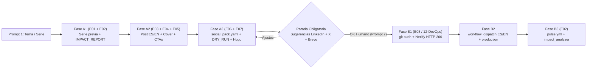

# 🔁 Playbook Oficial de Ciclo de Series y Divulgación Controlada (`SPEC-SQUAD-SCRIBA`)

> **Versión:** `1.0.0` · **Estado:** `ACTIVE`  
> **Propietario:** [`E01-editorial-orchestrator`](file:///c:/Users/dalae/OneDrive/Emprendiendo/datalaria/specs/squad-editorial/E01-editorial-orchestrator.md) (en coordinación con `E02`–`E08`)  
> **Invariantes Vinculadas:** `INV-SCRIBA-1..5`, `INV-SCRIBA-SEO-SAFE`, `INV-SCRIBA-CHRONO`, `INV-AUTO-1..8`

---

## 1. Propósito Operativo
Establecer un **flujo reproducible en 2 Fases (Preparación Controlada → Push & Live tras OK humano)** para cada nuevo artículo perteneciente a una serie o pilar temático de Datalaria (*Proyecto Autopilot*, *Datalaria Pulse*, *Datalaria Helix*, *Estrategia & Operaciones*, *Pioneros y Referentes*, *Cultura Tech y Media*).

El objetivo es garantizar que cada entrega nueva herede **el estilo narrativo, la coherencia visual y los patrones que mejor convierten en GA4/GSC**, evitando publicaciones ciegas sin aprobación humana previa de las entradas de LinkedIn y X/Twitter.

---

## 2. Arquitectura del Ciclo en 2 Fases (`INV-SCRIBA-5`)

---

## 3. FASE A — Inteligencia de Serie, Construcción y Propuesta Social (SIN `git push`)

1. **A1. Auditoría de Continuidad e Impacto (`E01` + `E02`):**
   - Leer los últimos 2–4 capítulos de la serie en `content/{es,en}/posts/` para capturar voz, hooks iniciales, formato de código/diagramas y estética de `cover.png`.
   - Consultar [`specs/audit/IMPACT_REPORT.md`](file:///c:/Users/dalae/OneDrive/Emprendiendo/datalaria/specs/audit/IMPACT_REPORT.md) y `data/pulse/private/metrics.json` para identificar qué enfoques y longitudes traccionan mejor dentro de esa serie/categoría y corregir errores históricos (p. ej. títulos `> 95` chars truncados).
2. **A2. Redacción Bilingüe, Portada y Monetización Segura (`E03` + `E04` + `E05`):**
   - Crear `content/es/posts/<slug-es>/index.md` y `content/en/posts/<slug-en>/index.md` con `translationKey` idéntico, `title` en `[35, 95]` chars, `description` en `[75, 245]` chars y taxonomía completa (`INV-TAX-1`).
   - Generar `cover.png` (`1200×630 px`, foco centrado en *safe zone* coherente con la serie) en ambos bundles.
   - Insertar puentes `INV-SCRIBA-CHRONO` exclusivamente hacia recursos/apps/posts ya publicados (`draft: false` y `date <= hoy`). Si el artículo abre paso a un lanzamiento próximo bajo embargo, usar *teaser* narrativo sin enlaces rotos `404`.
3. **A3. Paquete Omnicanal y Gate Local (`E06` + `E07`):**
   - Crear `social_pack.yaml` (`es:` y `en:` con secciones `x`, `linkedin`, `newsletter`, `devto`, `coderlegion`) cumpliendo el esquema `SocialPack`.
   - Ejecutar `python -m ops.pulse.build_index`, `python -m ops.pulse.publish_public`, `DRY_RUN=true` con `orchestrator.py` sobre ES y EN (`Quality Gate Autopilot 2.0: PASS`), `pytest` y `hugo --renderToMemory`.
4. **A4. Parada Obligatoria (`Human-in-the-Loop`):**
   - **Prohibido hacer `git commit`, `git push` o disparar APIs Live en Fase A.**
   - Presentar al usuario el resumen SEO (`100/100`), portada verificada y las **sugerencias completas de LinkedIn (ES/EN), X/Twitter (gancho `< 200`, hilo `4–6` tweets y enlaces 1-clic `X Web Intent` coste `0 €`), Brevo 2.0 y Dev.to/CoderLegion**.

---

## 4. FASE B — Publicación Forzada y Cierre Analítico (Solo tras OK en Prompt 2)

1. **B1. Commit, Push y Verificación Pública:**
   - Aplicar eventuales retoques del usuario en `social_pack.yaml` o `index.md`, re-validar `DRY_RUN=true`, realizar commit atómico y ejecutar `git push origin main` para actualizar GitHub y Netlify.
   - Comprobar `HTTP 200` en las URLs públicas `https://datalaria.com/es/posts/...` y `https://datalaria.com/en/posts/...` antes de sindicar (`canonical_url` / `source_url`).
2. **B2. Despacho Controlado Multi-Canal (`E08`):**
   - Lanzar `gh workflow run autopilot.yml -f file_path="<ruta_es>"` y `-f file_path="<ruta_en>"` para garantizar que ambos idiomas se ejecuten sin omitir ninguno.
   - Notificar al usuario para aprobar `environment: production`, verificar logs de LinkedIn, Dev.to, CoderLegion (`/api/v1/posts`) y Brevo (#3/#4), y entregar los enlaces finales más los clics directos de `X Web Intent`.
3. **B3. Retroalimentación Post-Publicación (`E02`):**
   - Ejecutar `gh workflow run pulse.yml` / `python -m ops.pulse.impact_analyzer` para actualizar [`specs/audit/IMPACT_REPORT.md`](file:///c:/Users/dalae/OneDrive/Emprendiendo/datalaria/specs/audit/IMPACT_REPORT.md) y nutrir las decisiones de la siguiente entrega.
