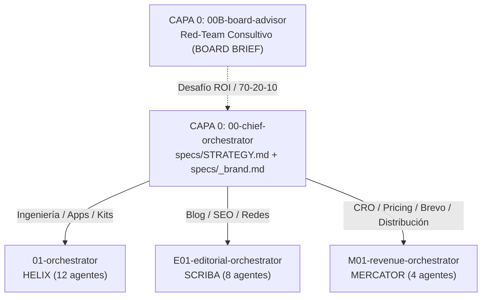

# 🧠 Datalaria OS — Capa 0 de Gobierno Estratégico y Federación (`specs/squad-os/`)

> **Fuente Única de Verdad (`ADR-034` / `INV-OS-1`):** Este directorio aloja la **Capa 0** del sistema operativo multi-escuadrón **Datalaria OS**, que coordina estratégicamente los 3 escuadrones especializados (**Helix**, **Scriba** y **Mercator**) sin micro-gestionar agentes individuales y sin romper el empaquetado comercial de **Datalaria Helix (12 agentes)**.

---

## 1. Arquitectura Federada en 3 Capas

## 2. Regla de Subsidiariedad y Bypass de Coste 0 (`INV-OS-1`)
1. **Bypass Directo (`0` tokens extra):** Cualquier tarea mono-dominio (`XS`, `S`, o `M` acotada a un solo escuadrón) entra directamente a `01-orchestrator`, `E01-editorial-orchestrator` o `M01-revenue-orchestrator` sin cargar `00-chief-orchestrator`, `00B-board-advisor` ni `STRATEGY.md`.
2. **Activación Multi-Escuadrón y Red-Team (`ADR-035`):** `00-chief-orchestrator` coordina lanzamientos transversales y estrategia (`L`/`XL`), mientras `00B-board-advisor` audita bajo demanda nuevos contenidos, apps, precios o cambios operativos con su tarjeta `BOARD BRIEF` (sin veto bloqueante; la decisión final siempre es del fundador).
3. **Bus de Datos Único:** Los 3 escuadrones comparten realidad empírica mediante `ops/pulse/` (`IMPACT_REPORT.md` en Doble Capa Bruto + Externo Neto y `executive_state.json` privado bajo `INV-PULSE-13`), nunca por duplicación manual de informes.

## 3. Catálogo de Capa 0
| ID | Icono y Rol | Misión Principal | ¿Código Prod? | ¿Veto? |
| :--- | :--- | :--- | :-: | :-: |
| [`00-chief-orchestrator`](file:///c:/Users/dalae/OneDrive/Emprendiendo/datalaria/specs/squad-os/00-chief-orchestrator.md) | 🧠 **Director Estratégico / Chief Orchestrator** | Custodia `STRATEGY.md`, enruta iniciativas multi-escuadrón entre `01`, `E01` y `M01`, controla el balance `70/20/10` y vigila `INV-OS-3`. | ❌ No | ❌ No |
| [`00B-board-advisor`](file:///c:/Users/dalae/OneDrive/Emprendiendo/datalaria/specs/squad-os/00B-board-advisor.md) | 🦅 **Consultor Directivo / Business Angel** | Red-Team estratégico consultivo: emite `BOARD BRIEF` (ROI, cuota `70/20/10`, tráfico neto, compuertas de reinversión/Apex/Media) sin veto bloqueante. | ❌ No | ❌ No |
